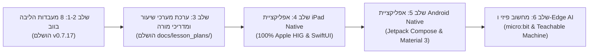

# מפת דרכים הנדסית ופדגוגית: פלטפורמת ZenLab
## תוכנית התפתחות רב-שנתית: מווב ועד Native iPadOS, מערכי שיעור, ומחשוב פיזי

**מזהה מסמך:** `ZEN-ROADMAP-HE-2026`  
**גרסה עדכנית:** `v0.7.17` (עודכן: אוקטובר 2026)  
**צוות:** Code & AI Explorer Team (`team@learnai.internal`)  
**משטר פיתוח:** Zero-PII Strict Compliance • 10th Man Red Team Protocol • רישיון פרויקט MIT  

מסמך זה מהווה את **מקור הזיכרון המרכזי (Central Source of Truth)** לכל הרעיונות, ההחלטות הארכיטקטוניות, המחקרים ומפת הדרכים של פרויקט ZenLab.

---

---

## שלב 1 ו-2: תשתית הליבה ו-8 מעבדות הווב (הושלם במלואו – גרסה v0.7.17)

### א. תשתית צד-לקוח, מנועים עצמאיים ועיצוב Zen 2.0
- [x] **Zero-PII Compliance & Git Hygiene**: שלילה מוחלטת של פרטים אישיים, אימיילים או נתיבי קבצים מקומיים.
- [x] **שפת עיצוב Zen 2.0**: ממשק זכוכית כהה (Deep Slate `#090D16`), ללא זרחנות או רעש חזותי, צלמיות `lucide-react` בלבד במערכת, תמיכה מלאה ב-RTL (Heebo/Rubik).
- [x] **מנוע סאונד מבוסס Web Audio API (`src/core/audio.js`)**: סינתזת צלילים נקייה ללא קבצים חיצוניים, כולל **אקורד פנטטוני מהדהד ומרגיע (Pentatonic Zen Chime)** עם מנגנון Debounce להגנה מרעש.
- [x] **מנוע חלקיקים ואנימציית כוכבים מרחפים (`src/core/starEffects.js`)**: מעוף אורגני של כוכבים מהאתגר הפתור אל מונה הכוכבים בראש העמוד.
- [x] **מנוע שמירה מקומית ריאקטיבי (`src/core/storage.js`)**: מעקב 24 כוכבים, שמירת חיות מותאמות אישית, ואפשרות איפוס.
- [x] **מנוע קריינות קולית (`src/core/narration.js`)**: הקראת משימות מובנית לסיוע לתלמידים מתקשים בקריאה.
- [x] **סרגל הנחיית משימה דינמי (`LabMissionGuide.jsx`)**: ליווי צעד-אחר-צעד בכל 8 המעבדות עם מגירת רמזים מתקפלת.
- [x] **תמיכת אופליין ו-PWA מלאה (`public/sw.js`)**: Service Worker מובנה המאפשר עבודה חלקה בכיתות ללא אינטרנט.
- [x] **חיבור שרת קצה חכם (Cloudflare Edge Function - `/api/tutor`)**: חונך AI פדגוגי מבוסס Gemini לשאלות תלמידים.

### ב. מסלול 1: עקרונות המחשב, חומרה ואלגוריתמיקה
- [x] **מעבדה 1: ציור בפיקסלים וביטים (`Lab1_BinaryPixels`)**: רשת $8 \times 8$, סנכרון 64 ביט וייצוג Hex, תבניות (לב, סמיילי, חרב), **וייצוא תמונת PNG ברזולוציה גבוהה ($512 \times 512$)**.
- [x] **מעבדה 2: רובוט אלגוריתמי ומבוך הפקודות (`Lab2_AlgorithmicRobot`)**: מבוך $6 \times 6$, תור פקודות FIFO, איסוף מפתח ופתיחת שער, ו**כפתור 'צעד בודד' (Single-Step) לדיבאגינג מודרך**.
- [x] **מעבדה 3: עץ החלטות בלשי (`Lab3_DecisionTree`)**: בונה עצים אינטראקטיבי, פיצולי תכונות, מדד טוהר (Purity), ו**ארגז חול להוספת חיה מקורית עם אימוג'י ומאפיינים (כולל תמיכה בעקרון שובך היונים)**.
- [x] **מעבדה 4: הווייז של הרובוט ומבוך החיפוש (`Lab4_Pathfinder`)**: מבוך $8 \times 8$, הצבת מכשולים, והשוואת יעילות סריקה בין BFS ל-A* Heuristic (תיקון Tie-Breaking המדגים עליונות מובהקת של 15 צמתים מול 64).

### ג. מסלול 2: תפיסה, למידת מכונה ובינה מלאכותית
- [x] **מעבדה 5: מסווג למידת מכונה (`Lab5_MachineLearningClassifier`)**: מרחב תכונות 2D (משקל מול גודל), הזנת נקודות אימון, גרירה חלקה של נקודת שאילתה, אלגוריתם k-NN וניתוח הטיות (Bias).
- [x] **מעבדה 6: מעבדת ראייה ממוחשבת ופילטרים (`Lab6_VisionKernels`)**: קונבולוציה $3 \times 3$, פילטרים לזיהוי קצוות (Sobel אופקי ואנכי בערך מוחלט), חידוד וטשטוש, ומפרק חישוב תא בודד.
- [x] **מעבדה 7: נוירון חכם ופרספטרון מלאכותי (`Lab7_Perceptron`)**: נוירון בודד, סליידרים למשקולות והטיה, קו הפרדה לינארי, שערי AND/OR ומגבלת שער ה-XOR.
- [x] **מעבדה 8: מודל שפה, טוקניזציה וחיזוי מילים (`Lab8_LanguageModelPredictor`)**: פירוק לטוקנים, התפלגות הסתברויות Softmax, סליידר טמפרטורה (0.0 שמרן מול 1.5 יצירתי/הוזה), והרכבת משפטים.
- [x] **תעודת הצטיינות רשמית להדפסה (`CertificateModal`)**: הפקת תעודה לפי כוכבים (עד 24 כוכבים) לשמירה כ-PDF ללא שום איסוף נתונים.

---

## שלב 3: ערכת ההוראה הכיתתית ומערכי השיעור (הושלם במאגר – תיקיית `docs/lesson_plans/`)

כדי להפוך את ZenLab מכלי משחק עצמאי של שעתיים ל**תוכנית לימודים סמסטריאלית מקיפה של 8–12 שבועות**:
- [x] **סילבוס מלא ו-8 מערכי שיעור מובנים ל-45 דקות (ו-90 דקות)**:
  - `01_PIXELS_AND_BINARY.md` (מעבדה 1)
  - `02_ALGORITHMIC_ROBOT.md` (מעבדה 2)
  - `03_DECISION_TREE.md` (מעבדה 3)
  - `04_PATHFINDER_A_STAR.md` (מעבדה 4)
  - `05_KNN_CLASSIFIER.md` (מעבדה 5)
  - `06_VISION_CONVOLUTION.md` (מעבדה 6)
  - `07_NEURON_PERCEPTRON.md` (מעבדה 7)
  - `08_LLM_TOKENIZER.md` (מעבדה 8)
- [x] **תכולה פדגוגית שלמה בכל מערך**:
  - פעילות פתיחה ללא מחשב (Unplugged Activity – 7 דקות).
  - תסריט מהלך שיעור דקה-אחר-דקה למורה.
  - מדריך פיצוח מעשי ל-3 אתגרי ZenLab.
  - משימת יצירה חופשית בארגז החול (Sandbox).
  - 4 תפיסות שגויות נפוצות (Misconceptions) ודרכי פירוקן.
  - דיפרנציאציה: פיגומים למתקשים מול אתגרי העמקה למצטיינים.
  - דף עבודה מודפס לתלמיד (Printable Worksheet).
  - מחוון הערכה פדגוגי (Rubric).
  - משימת המשך למשפחה ולבית (Family AI Quest).
- [ ] **שילוב פורטל מורים ייעודי בממשק האתר (Teacher Portal UI)**:
  - כפתור "מדריכי שיעור למורה" בסרגל העליון לצפייה, הדפסה והורדה ישירה של המערכים ודפי העבודה.

---

## שלב 4: אפליקציית ה-iPad & iOS המקורית (100% Apple Native)

השלב האסטרטגי להפיכת ZenLab למוצר Native יוקרתי לעגלות טאבלטים בבתי ספר:
- [x] **מחקר שוק השוואתי וניתוח כשלים FMEA** (`docs/research/NATIVE_APPS_FEASIBILITY_AND_MARKET_STUDY.he.md`).
- [x] **מפרט ארכיטקטורה מפורט RFC 003** (`docs/proposals/RFC_003_NATIVE_APPLE_AND_ANDROID_ARCHITECTURE.he.md`).
- [ ] **Phase 0: הקמת סביבת Monorepo (`ios/ZenLab`)**:
  - הגדרת קובץ `shared/curriculum.json` כ-Single Source of Truth משותף.
  - יצירת פרויקט Xcode מנוהל SPM בלבד (ללא CocoaPods).
- [ ] **Phase 1: תשתית הליבה של Apple HIG**:
  - `NavigationSplitView` ב-iPad (מתקפל ל-`NavigationStack` ב-iPhone ול-Mac Catalyst/Silicon).
  - חומריות זכוכית נוזלית (`.ultraThinMaterial`) וצלמיות SF Symbols 6.
  - מנוע צלילים פנטטוני ב-`AVAudioEngine` המכבד את מתג ההשתקה (`.ambient`).
  - משוב מגע עשיר ב-`CoreHaptics` (פעימות הצלחה וקליקים מכניים למתגים).
  - אחסון מקומי ב-`SwiftData` (Local-First) עם סנכרון שקט אופורטוניסטי ב-`CloudKit`.
  - נעילת קנבס חישובי ל-LTR עם מעטפת עברית RTL טבעית.
- [ ] **Phase 2: יישום 8 המעבדות ב-SwiftUI & Metal Canvas**:
  - רינדור מואץ חומרה ב-120fps למטריצות, רשתות ונוירונים.
  - מודל סנכרון תוכן דינמי (Server-Driven Curriculum) מהקצה של Cloudflare.
- [ ] **Phase 3: הפצה ב-App Store וב-Apple School Manager (VPP)**:
  - מחיר סמלי ($1.99–$2.99 עם 50% הנחה למוסדות) לכיסוי עלויות חשבון מפתח ($99/שנה).
  - שער הורים מתמטי (Parental Gate) ותאימות מחמירה לקטגוריית Kids (Guideline 1.3 / 5.1.4).

---

## שלב 5: אפליקציית אנדרואיד מקורית (Jetpack Compose & Material 3)

לאחר ייצוב ה-iOS, תרגום המערכת לפלטפורמת אנדרואיד:
- [ ] פרויקט `android/` ב-Jetpack Compose ו-Kotlin.
- [ ] חומריות Material 3 Surfaces ואפקט Blur/RenderEffect (Android 12+).
- [ ] סנכרון נתונים מקומי באמצעות `Room Database` (תואם לסכמת SwiftData).
- [ ] סינתזת שמע ב-AudioTrack / Oboe C++ עם שיהוי אפסי.

---

## שלב 6: מחשוב פיזי וגשר Teachable Machine (עתידי)

- [ ] **חיבור לחומרה פיזית (Web Serial & Web Bluetooth)**:
  - חיבור ישיר לכרטיסי **BBC micro:bit** ו-**Arduino Nano ESP32**.
  - הזרמת נתוני חיישנים חיים (מד תאוצה, עוצמת אור, כפתורים) ישירות למסווג ה-ML ולרובוט.
- [ ] **ייבוא מודלים מ-Google Teachable Machine**:
  - מודול ייבוא מודלים מותאמים אישית (TensorFlow.js) להרצה מקומית בקצה (Edge Inference).
- [ ] **מצב שידור כיתתי למורה (Classroom Broadcast Mode)**:
  - סנכרון P2P (WebRTC) של לוח המורה למסכי התלמידים בכיתת המחשבים ללא תלות בשרת מרכזי.
