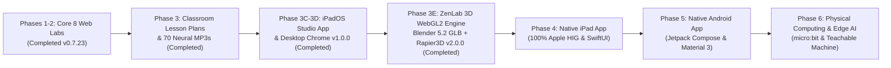

# Engineering Roadmap: ZenLab Universal Educational Platform
## Multi-Year Technical & Pedagogical Evolution: Web SPA, Native iPadOS, Lesson Plans, and Physical Computing

**Document ID:** `ZEN-ROADMAP-EN-2026`  
**Current Version:** `v2.0.0` (Updated: October 2026)  
**Team:** Code & AI Explorer Team (`team@learnai.internal`)  
**Governance:** Zero-PII Strict Compliance • 10th Man Red Team Protocol • MIT License  

This document serves as the **Central Source of Truth** for all collective memory, architectural decisions, comparative research, and strategic roadmaps for the ZenLab project.

---

---

## Phases 1 & 2: Client Infrastructure & 8 Core Web Labs (Completed - v0.7.23)

### A. Core Platform Engines & Zen 2.0 Design System
- [x] **Zero-PII Compliance & Git Hygiene**: Absolute prohibition of personal names, emails, or absolute machine paths in code and commits.
- [x] **Zen 2.0 Design Tokens**: Deep Slate (`#090D16`), zero neon clutter, `lucide-react` icons strictly for system UI, native Hebrew RTL typography (Heebo/Rubik).
- [x] **Web Audio API Engine (`src/core/audio.js`)**: Real-time sine wave synthesis, **debounced Pentatonic Zen Chimes** (C5, E5, G5, C6) preventing auditory overload.
- [x] **Physics Star Particle Animation (`src/core/starEffects.js`)**: Gentle floating star particles launching upon challenge completion to `#zen-stars-header-badge`.
- [x] **Reactive Local Storage Engine (`src/core/storage.js`)**: 24-star tracking, custom animals persistence, and state reset capabilities.
- [x] **Speech Synthesis Narration (`src/core/narration.js`)**: Built-in audio mission reading for 5th-grade emergent readers.
- [x] **Dynamic Mission Guide Banner (`LabMissionGuide.jsx`)**: Step-by-step guidance across all 8 labs with expandable hint drawer.
- [x] **Offline PWA & Service Worker (`public/sw.js`)**: Production-grade caching strategy enabling 100% offline classroom use.
- [x] **Edge AI Tutor (`functions/api/tutor.js`)**: Serverless Gemini edge function answering Hebrew pedagogical queries.

### B. Track 1: Computational Thinking & Algorithms
- [x] **Lab 1: Binary Pixels (`Lab1_BinaryPixels`)**: 8x8 toggle matrix, 64-bit string synchronization, Hex representation, presets, and **high-res 512x512 PNG image export**.
- [x] **Lab 2: Algorithmic Robot (`Lab2_AlgorithmicRobot`)**: 6x6 grid maze, FIFO command queue, key/gate mechanics, and **interactive Single-Step debugging execution**.
- [x] **Lab 3: Decision Tree Detective (`Lab3_DecisionTree`)**: Interactive binary tree builder, feature splits, purity metrics, and **custom animal sandbox modal (pigeonhole principle aware)**.
- [x] **Lab 4: State Space Pathfinder (`Lab4_Pathfinder`)**: 8x8 grid maze, obstacle placement, BFS vs. A* Heuristic comparison with heuristic tie-breaking (15 nodes explored vs. 64 in BFS).

### C. Track 2: Perception, Machine Learning & Modern Generative AI
- [x] **Lab 5: Machine Learning Classifier (`Lab5_MachineLearningClassifier`)**: 2D feature space, training points, smooth query point drag, k-NN algorithm, and training bias analysis.
- [x] **Lab 6: Vision Kernel Studio (`Lab6_VisionKernels`)**: 3x3 convolution kernels (Sobel vertical/horizontal magnitude, sharpen, blur), and sliding window pixel inspector.
- [x] **Lab 7: The Perceptron Switch (`Lab7_Perceptron`)**: Single-layer artificial neuron, weight/bias sliders, 2D linear decision boundary, AND/OR logic gates, and historic XOR failure.
- [x] **Lab 8: Language Model Predictor (`Lab8_LanguageModelPredictor`)**: Next-token prediction, Softmax probability distribution, Temperature slider (0.0 to 1.5), and sentence generation.
- [x] **Printable Certificate of Excellence (`CertificateModal`)**: Official printable award based on stars earned (up to 24 stars) with zero data collection.

---

## Phase 3: Classroom Curriculum & Lesson Plans Suite (Completed in `docs/lesson_plans/`)

Transforming ZenLab from a 2-hour solo experience into an **8-to-12 week structured school curriculum**:
- [x] **Comprehensive 8-Lesson Plan Suite (45-min & 90-min double period)**:
  - `01_PIXELS_AND_BINARY.md` (Lab 1)
  - `02_ALGORITHMIC_ROBOT.md` (Lab 2)
  - `03_DECISION_TREE.md` (Lab 3)
  - `04_PATHFINDER_A_STAR.md` (Lab 4)
  - `05_KNN_CLASSIFIER.md` (Lab 5)
  - `06_VISION_CONVOLUTION.md` (Lab 6)
  - `07_NEURON_PERCEPTRON.md` (Lab 7)
  - `08_LLM_TOKENIZER.md` (Lab 8)
- [x] **Every Lesson Plan Includes**:
  - 7-minute Unplugged physical activity.
  - Minute-by-minute teacher classroom script.
  - Guided solutions for all 3 ZenLab challenges.
  - Creative sandbox extension.
  - 4 common student misconceptions and resolutions.
  - Differentiated learning (scaffolding vs. gifted extensions).
  - Printable double-sided student worksheet.
  - 4-tier assessment rubric.
  - Family AI Quest.
- [ ] **Teacher Portal UI in Web App**:
  - Dedicated "מדריכי הוראה לכיתה" navigation tab for one-click viewing and printing of lesson plans and worksheets.

---

## Phase 3B: Complete Voice & Audio Modernization (Completed v0.7.23)

- [x] **100% Pre-rendered Neural Voice Assets (70 studio files)**:
  - 46 Tutor Q&A and greeting files (`public/audio/tutor/*.mp3`).
  - 24 Challenge hint files (`public/audio/hints/labX_chY.mp3`).
- [x] **Inclusive Plural Alignment**:
  - Full alignment of audio scripts with inclusive classroom Hebrew ("שלכם", "אנחנו חוקרים יחד", "תרצו לשאול").
- [x] **Acoustic Calibration**:
  - True 1.0x playback speed, energetic 1.04x fallback rate, and automated regex stripping for emojis and quotation marks.
- [x] **Architectural Research Paper**:
  - Published `docs/research/hebrew_tts_voice_modernization_2026.md` comparing ElevenLabs, OpenAI TTS, Google Cloud Journey, WASM Piper, and Apple ANE Siri Enhanced.

---

## Phase 3C: Site-Wide Matific-Grade Living Toy & Embedded X-Ray Code Lens (Completed v0.7.24 – v0.8.1)

Strategic UI/UX transformation bridging tactile early-childhood manipulatives (Matific / Toca Boca) with authentic Computer Science & AI depth:
- [x] **Dual-Mode Classroom Accessibility (`v0.7.24`)**:
  - Added "מצב דפים (כיתה מוארת)" (`isDapimActive`) for high-contrast sunlit classroom projectors alongside Dark Mode.
- [x] **Cosmic Overworld Journey Map & 2-Phase Progressive Disclosure (`v0.7.25` & `v0.8.0`)**:
  - Built `AdventureJourneyMap.jsx` ("מפת הכוכבים של זֶן") with an 8-station winding constellation path, unified Command Bridge (`ZenLivingAvatar`, developer rank progression, 24-star progress bar, Certificate & Glossary triggers), and a 100% reversible toggle back to the classic grid (`📋 תצוגת מעבדות כיתתית`).
  - Split every lab into **Phase 1: Media & Theory Briefing (`TheoryView.jsx`)** and **Phase 2: Interactive Toy Stage** via `LabPhaseHeader.jsx`.
- [x] **Shared Living Toy Core & Embedded X-Ray Code Lens (`v0.7.26` – `v0.8.0`)**:
  - Created `ZenLivingAvatar.jsx` (living SVG robot companion with expressive moods and antenna states) and `LudicLabShell.jsx` (cosmic toy chassis, satellite telemetry header, floating "איך זה עובד?" popover, 3 star collector jars, and the unified `עדשת קוד` toggle).
  - Expanded the Matific-grade Living Toy + X-Ray Code Lens across **all 8 Labs** (`MatificPilotLab1.jsx` through `MatificLab8Llm.jsx`), each with a 100% reversible view switcher (`🌟 פיילוט משחקי (Matific)` vs `🔬 מעבדה מדעית`).
- [x] **Zero-Layout-Shift (`CLS = 0` / `ΔY = 0px`) & 60fps DOM Eye Tracking Stabilization (`v0.8.1`)**:
  - Replaced React `useState` mousemove listeners with direct DOM `useRef` + `requestAnimationFrame` (`translate3d`) pupil transforms.
  - Locked heights of all X-Ray formula bars, `IF/ELSE` badges, Manhattan heuristic bars, neighbor voting grids, and convolution ribbons (`ΔY = 0px` verified via automated Playwright suite across Overworld and Labs 1–8).
- [x] **Architectural RFC**:
  - Codified in `docs/proposals/RFC_004_MATIFIC_LUDIC_ENGINE_AND_XRAY_LENS.he.md` and `RFC_004_MATIFIC_LUDIC_ENGINE_AND_XRAY_LENS.md`.
- [x] **Phase 3D: iPadOS Flagship Studio App + Desktop Chrome Parity & Full-Site Hebrew Audio/Copy Audit (`v1.0.0`)**:
  - **`LudicLabShell 3.0` (Zen Dynamic Island Command Bar)**: Eliminated the 220px vertical robot stage blocker and double yellow cartoon borders; integrated `<ZenLivingAvatar size="sm" />`, mission banner, `🔊 השמע משימה` studio MP3 button (`/audio/hints/labX_chY.mp3`), `עדשת קוד` toggle, `איך זה עובד?` studio audio popover (`/audio/narration/labX.wav`), and 3 Bespoke Star Badges into a compact floating command bar — lifting all 8 interactive lab stages ~220px higher (Above the Fold).
  - **`TheoryView 3.0` (4-Step Interactive Card Deck + Full-Page Toggle)**: Replaced the 4,000px vertical scroll wall with a 4-step studio deck (`1. סרטון וסיפור` | `2. נסו בעצמכם` | `3. בעולם האמיתי` | `4. חידון הבנה`), keyboard navigation (`←`/`→`), studio voice buttons, and a 1-click full-page view toggle.
  - **`AdventureJourneyMap 3.0` (World Filter Hub)**: Added World Filter Pills (`כל העולמות (8)` | `עולם 1–4`), collapsible `שדרוגי זֶן` drawer, and `🔊 שמעו את זֶן` studio welcome audio button (`/audio/tutor/home_welcome.mp3`).
  - **Acoustic Rate Calibration & Age 10–11 Copy Audit**: Prevented double-acceleration of pre-rendered `+12%` MP3s (`getEffectivePlaybackRate()`), expanded Hebrew TTS phonetic rules, removed all developer/marketing slogans (`From Zero to Neural`, `NotebookLM`, `בסגנון Brilliant`), and aligned Lab 4–8 challenge instructions with UI button labels.
- [ ] **Future External Ludic Engine Research (Optional Phase 4+ Bridge)**:
  - Evaluation of Rive State Machines, Godot 4 Wasm, or Flutter + Flame for native mobile parity while keeping `curriculum.json` decoupled.

---

## Phase 4: Native iPad & iOS Application (100% Apple Native)

Strategic expansion to deliver a premium, Apple HIG-compliant app for school iPad carts:
- [x] **Competitive Market Study & FMEA Failure Mode Analysis** (`docs/research/NATIVE_APPS_FEASIBILITY_AND_MARKET_STUDY.he.md`).
- [x] **RFC 003 Native Architecture Specification** (`docs/proposals/RFC_003_NATIVE_APPLE_AND_ANDROID_ARCHITECTURE.he.md`).
- [x] **Minimum OS & Hardware Target (iPadOS 17.0 Minimum Target)**:
  - Broad backward compatibility starting with **iPad 7th gen (2019)**, ensuring 100% support for the thousands of **iPad 8th gen (2020) and iPad 9th gen (2021)** carts deployed across Israeli schools (Geffen / Digital Israel).
  - Unlocks modern Swift 6 capabilities: native `SwiftData` for local-first storage and `@Observable` macro without legacy Combine boilerplate.
- [ ] **Phase 0: Monorepo Foundation (`ios/ZenLab`)**:
  - Shared declarative contract `shared/curriculum.json` (Single Source of Truth).
  - Clean Xcode project using Swift Package Manager (SPM) only.
- [ ] **Phase 1: Apple HIG Core Frameworks**:
  - `NavigationSplitView` on iPad (collapsing to `NavigationStack` on iPhone, native on Apple Silicon Mac).
  - Liquid Glass (`.ultraThinMaterial`) and SF Symbols 6.
  - `AVAudioEngine` for low-latency pentatonic synthesis respecting silent switch (`.ambient`).
  - `CoreHaptics` for tactile switch feedback and challenge completion pulses.
  - `SwiftData` Local-First storage with opportunistic, non-blocking `CloudKit` sync (solving shared school iPad MDM constraints).
  - Computational LTR canvas locked with natural Hebrew RTL surrounding UI.
- [ ] **Phase 2: 8 Labs in SwiftUI & Metal Canvas**:
  - Hardware-accelerated 120fps Metal Canvas for pixel grids, pathfinding, and neural boundaries.
  - Dynamic Server-Driven Curriculum (SDC) synchronization over Cloudflare Edge.
- [ ] **Phase 3: Apple On-Device AI Integration (Zero-Cloud, 100% Zero-PII)**:
  - **NaturalLanguage Framework**:
    - `NLTokenizer`: Real-time on-device Hebrew tokenization for free-text sentences in Lab 8 (0ms latency).
    - `NLEmbedding`: Pre-trained on-device Hebrew vector embeddings for semantic word distances in Lab 5.
  - **Core ML & Apple Neural Engine (ANE)**:
    - Lab 6: Compare manual $3\times3$ Sobel convolution with high-speed Core ML CNN inference executing on the ANE in 1.2ms.
    - Lab 7: Demonstrate solving XOR limitation using a bundled deep neural network model.
  - **Vision Framework**:
    - Contour and shape recognition converting student finger/Apple Pencil drawings directly into $8\times8$ binary grids (Lab 1).
  - **App Intents & Siri**:
    - Voice commands for classroom management and lab resets ("Hey Siri, reset the robot maze in ZenLab").
- [ ] **Phase 4: App Store & Apple School Manager (VPP) Deployment**:
  - Nominal pricing ($1.99–$2.99 with 50% educational volume discount) to cover developer fees.
  - Mathematical Parental Gate and strict Kids Category (Guideline 1.3 / 5.1.4) compliance.

---

## Phase 5: Native Android Application (Jetpack Compose & Material 3)

Subsequent translation to Android:
- [ ] `android/` project using Kotlin and Jetpack Compose.
- [ ] Material 3 Surfaces and RenderEffect/Blur (Android 12+).
- [ ] `Room Database` matching SwiftData schema for local-first storage.
- [ ] Low-latency audio synthesis via `AudioTrack` or `Oboe (C++)`.

---

## Phase 6: Physical Computing & Teachable Machine Bridge (Future)

- [ ] **Hardware Interoperability (Web Serial & Web Bluetooth)**:
  - Direct connection to **BBC micro:bit** and **Arduino Nano ESP32**.
  - Live sensor streaming (accelerometer, light sensor, buttons) directly into the ML classifier.
- [ ] **Teachable Machine Model Ingestion**:
  - TensorFlow.js client-side importer for custom image and pose models trained on Google Teachable Machine.
- [ ] **Classroom Broadcast & Sync Mode**:
  - Peer-to-peer (WebRTC) screen and canvas synchronization from teacher display to student devices without central server overhead.
