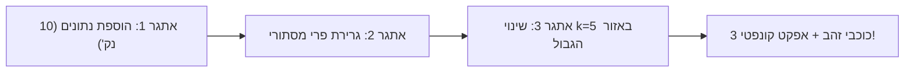

# מערך שיעור מובנה: מעבדה 5 – מסווג שכנים קרובים (k-NN) ולמידת מכונה
## מסלול ב׳: בינה מלאכותית ולמידת מכונה • בית ספר יסודי

---

### פרטי השיעור ונתוני מפתח
* **שכבת גיל:** בית ספר יסודי (גילאי 10–11).
* **משך השיעור:** 45 דקות (כולל מתווה הרחבה לסדנה כפולה של 90 דקות).
* **סביבת עבודה:** [ZenLab – מעבדה 5: מסווג למידת מכונה (`Lab5_MachineLearningClassifier`)].
* **דרישות מוקדמות:** היכרות בסיסית עם מערכת צירים (ציר X וציר Y משיעורי מתמטיקה), הבנת מושג הפיקסל (מעבדה 1).
* **תאימות לתוכנית הלימודים:** מחוון אוריינות בינה מלאכותית של משרד החינוך (מעבר מתכנות מבוסס חוקים ללמידה מבוססת דוגמאות), תקני **AI4K12** – רעיון מרכזי 3: למידה (Learning) ורעיון מרכזי 5: השפעה חברתית ואתיקה (Societal Impact & Ethics).
* **עקרון פדגוגי מרכזי:** **Glass-Box Learning** – חקר ויזואלי של אלגוריתם מתמטי ללא מחסומי קוד או תחביר, יישום ספירלת ברונר (פעיל $\to$ איקוני $\to$ סמלי), ושמירה מחמירה על אפס איסוף נתונים (Zero-PII).

---

### 1. מטרות הוראה אופרטיביות

בסיום השיעור, התלמיד/ה יהיו מסוגלים:
1. **ידע והבנה קוגניטיבית:**
   * להסביר במילים שלהם את ההבדל המהותי בין **תכנות מסורתי** (חוקים כתובים מראש) לבין **למידת מכונה** (חילוץ חוקים ודפוסים מתוך דוגמאות).
   * להגדיר מהם **נתוני אימון (Training Data)** מול **נתוני בדיקה/חיזוי (Inference/Testing)**.
   * להסביר כיצד אלגוריתם **k-NN (k-Nearest Neighbors)** מקבל החלטה לפי מרחק גאומטרי והכרעת רוב קולות בין השכנים הקרובים.
2. **מיומנות מחשובית וחקר מעשי:**
   * למפות עצמים על גבי **מרחב תכונות דו-ממדי (Feature Space)** המבוסס על שני משתנים (גודל ומשקל).
   * לחקור ולנתח את השפעת שינוי ערך היתר-פרמטר **$k$** ($k=1$, $k=3$, $k=5$) על יציבות קו ההפרדה והעמידות לרעש.
   * לזהות מצבי אי-ודאות (גבול החלטה) ולקרוא מדד ביטחון אלגוריתמי (Confidence Score באחוזים).
3. **הבנה אתית וחברתית (AI Ethics):**
   * להסביר מהי **הטיה בנתוני אימון (Training Bias)** וכיצד הזנת דוגמאות לא מאוזנות גורמת למערכת AI לטעות ולקפח קבוצות.
   * לגבש כללי אחריות באיסוף נתונים ליישומי בינה מלאכותית בעולם האמיתי (כגון רפואה, זיהוי פנים וסינון מועמדים).

---

### 2. מושגי מפתח להנחלה (Glossary)

| מושג בעברית | מושג מקצועי (CS/AI) | הסבר מותאם לגיל 10 |
| :--- | :--- | :--- |
| **למידת מכונה מונחית** | Supervised Learning | שיטה שבה מלמדים מחשב באמצעות דוגמאות שלכל אחת מהן מצורפת התשובה הנכונה ("תגית"). |
| **דוגמאות אימון** | Training Dataset | "ספרי הלימוד" של המחשב; מאגר הנתונים שהמחשב לומד ממנו את הדפוסים וההבדלים. |
| **מרחב תכונות** | Feature Space | לוח או גרף שבו כל ציר מייצג תכונה מספרית (למשל: ציר X = גודל, ציר Y = משקל). |
| **מרחק אוקלידי** | Euclidean Distance | המרחק בקו אווירי ישר בין שתי נקודות על הלוח, המחושב לפי ההפרש במיקומים שלהן. |
| **מסווג שכנים קרובים** | k-Nearest Neighbors (k-NN) | אלגוריתם חכם שמסווג פריט חדש לפי המחלקה של רוב השכנים שנמצאים הכי קרוב אליו במרחב. |
| **הכרעת רוב קולות** | Majority Voting | הדמוקרטיה של האלגוריתם: השכנים הקרובים "מצביעים", והסוג שקיבל הכי הרבה קולות מנצח. |
| **מדד ביטחון** | Confidence Score | אחוז הקולות של השכנים שתמכו בהחלטה (למשל: ב-$k=5$, אם 4 מתוך 5 הם תפוח, הביטחון הוא $80\%$). |
| **הטיה אלגוריתמית** | Training Bias | עיוות בתוצאות המחשב שנוצר מכך שדוגמאות האימון לא היו מגוונות או שוות בין הקבוצות. |

---

### 3. פעילות פתיחה ללא מחשב (Unplugged Activity, 7 דקות)
#### שם הפעילות: "הבלש והשכנים בכיתה – מי השכן שלי?"

**מטרת הפעילות:** המחשה גופנית חווייתית של מרחב תכונות דו-ממדי והצבעת שכנים לפני פתיחת המסכים.

**ציוד נדרש:**
* חבל או סרט סימון מודבק על רצפת הכיתה המייצג מערכת צירים (ציר X = גובה התלמיד, ציר Y = צבע החולצה: מבהיר לכהה).
* מדבקות עגולות בשני צבעים (אדום = תפוח, ירוק = אבטיח).

**מהלך הפעילות דקה אחר דקה:**
1. **דקה 0–2 (הגדרת המרחב):** המורה מסביר/ה: "הכיתה שלנו הופכת עכשיו למרחב הזיכרון של מחשב על! ציר הרצפה לאורך החלון מייצג גובה – תלמידים נמוכים בצד ימין, גבוהים בצד שמאל. ציר הרוחב מייצג את צבע הבגד – חולצות בהירות מקדימה, חולצות כהות מאחור."
2. **דקה 2–4 (מיקום דוגמאות אימון):** 6 תלמידים מתנדבים נעמדים על המרחב לפי שתי התכונות שלהם. המורה מחלק/ת להם מדבקות: 3 תלמידים מקבלים מדבקה אדומה ("תפוח") ו-3 תלמידים מקבלים מדבקה ירוקה ("אבטיח"). התלמידים מייצגים את **נתוני האימון**.
3. **דקה 4–6 (כניסת הפרי המסתורי ובדיקת k):**
   * תלמיד שביעי נכנס לכיתה בעיניים עצומות או כ"פרי מסתורי" ללא מדבקה ונעמד בנקודה מסוימת.
   * המורה שואל/ת: "המחשב צריך לדעת האם התלמיד החדש הוא תפוח או אבטיח. איך נחליט?"
   * **בדיקת $k=1$:** התלמיד שעומד הכי קרוב אליו בצעדים מרים יד. מה צבע המדבקה שלו? זו התשובה של המחשב!
   * **בדיקת $k=3$:** שלושת התלמידים הקרובים ביותר מרימים יד. הם עורכים הצבעה – מי הרוב?
   * **בדיקת $k=5$:** חמשת התלמידים הקרובים מצביעים.
4. **דקה 6–7 (שאלת פתיחה מאתגרת):**
   * *המורה:* "מה יקרה אם השכן הכי קרוב במקרה לבש חולצה כהה למרות שהוא בכלל תפוח? האם כדאי לסמוך רק על שכן אחד ($k=1$) או על כמה שכנים ביחד ($k=3$ או $k=5$)?"
   * התלמידים מזהים מיד שקבוצת שכנים מעניקה החלטה יציבה ובטוחה יותר. כעת עוברים למחשבים!

---

### 4. תסריט מהלך שיעור דקה-אחר-דקה (Lesson Timeline & Script)

```
┌─────────────────────────────────────────────────────────────────────────────┐
│                             ציר זמן השיעור (45 דק')                         │
├─────────────┬─────────────┬──────────────────────────┬──────────────────────┤
│  00 - 07 דק'│  07 - 15 דק'│        15 - 32 דק'       │ 32 - 40 דק'│ 40-45 דק│
│  פעילות ללא │ תיווך מושגי │  התנסות מעשית ב-ZenLab   │ דיון אתיקה │ סיכום   │
│    מחשב     │ והדגמת לוח  │ 3 אתגרים + ניסוי ערכי k  │  והטיות    │ וכרטיס  │
│ (Unplugged) │ (Frontal)   │ (Hands-on Exploration)   │   (Bias)   │  יציאה  │
└─────────────┴─────────────┴──────────────────────────┴──────────────────────┘
```

#### שלב 1: פתיחה וחיבור לעולם האמיתי (דקות 07:00 – 15:00)
* **דברי המורה (הוראה מתווכת):**
  > "במעבדות הקודמות ראינו איך רובוט הולך לפי פקודות מדויקות שכתבנו לו צעד אחר צעד. אבל חשבו רגע: איך הטלפון של ההורים מזהה את הפנים שלהם? האם מתכנת ישב וכתב: 'אם יש אף באורך 4 סנטימטר ושתי עיניים חומות – זה אבא'? ברור שלא! בעולם האמיתי יש אינסוף אפשרויות.
  > היום נגלה את המהפכה של **למידת מכונה (Machine Learning)**: במקום לכתוב חוקים קשיחים, אנחנו מראים למחשב דוגמאות רבות. המחשב מסדר אותן על לוח חכם לפי התכונות שלהן, וכשמגיע פריט חדש – הוא בודק מי השכנים הכי קרובים אליו!"
* **הצגת הממשק בלוח המרכזי:**
  * המורה מקרין/ה את [מעבדה 5 ב-ZenLab].
  * מציגים את לוח ההשוואה: ציר X (גודל: קטן $\to$ גדול) וציר Y (משקל: קל $\to$ כבד).
  * מראים את הנקודות הקיימות: תפוחים אדומים בצד שמאל למטה (קטנים וקלים יחסית), אבטיחים ירוקים בצד ימין למעלה (גדולים וכבדים).
  * מראים את הנקודה הלבנה הזוהרת במרכז – "הפרי המסתורי" שמחפש את זהותו.

#### שלב 2: התנסות אישית/בזוגות במעבדה ופיצוח אתגרים (דקות 15:00 – 32:00)
התלמידים פותחים את המחשבים / כרומבוקים ונכנסים למעבדה 5. הם עובדים לפי כרטיסיית החקר (מצורפת בסעיף 10).

* **מעקב המורה בכיתה ושאלות הנחיה בזמן אמת:**
  * *מול תלמיד שמניח נקודות באקראי:* "שים לב איפה נמצאים רוב התפוחים בלוח. אם תשים תפוח בפינה של האבטיחים (משקל 90 וגודל 90), מה יקרה למחשב כשינסה לנחש?"
  * *מול תלמיד שבודק את הנקודה הלבנה:* "גרור את הפרי הלבן בדיוק לאמצע (50, 50). מי השכנים הכי קרובים אליו? מה אחוז הביטחון שלו?"
  * *מול תלמיד שמשנה את ערך $k$:* "שנה עכשיו מ-$k=1$ ל-$k=5$. האם קווי החיבור הכחולים התרבו? מה השתנה בהצבעה?"

#### שלב 3: חקר מעמיק – ניסוי ערך k וגבולות ההחלטה (דקות 32:00 – 40:00)
עצירת עבודה קצרה ודיון ממוקד בלוח:
* **שאלת המורה:** "מה קורה כשאנחנו בוחנים פרי שנמצא בדיוק על הגבול שבין התפוחים לאבטיחים?"
* **ניסוי מבוקר על מסך המורה:**
  1. נציב את הפרי בנקודה $(45, 50)$.
  2. כאשר $k=1$: השכן הבודד הקרוב ביותר הוא תפוח $\to$ המחשב קובע: "תפוח ב-100% ביטחון!".
  3. כאשר $k=3$: שני שכנים הם אבטיח ואחד תפוח $\to$ ההכרעה מתהפכת לאבטיח ב-67% ביטחון!
  4. כאשר $k=5$: 3 אבטיחים ו-2 תפוחים $\to$ אבטיח ב-60% ביטחון.
* **הסבר המורה על רעש (Noise) והטיה:**
  > "כש-$k=1$, המחשב עלול להיות פזיז: אם במקרה יש לנו תפוח ענק וחריג (דוגמה רועשת), המחשב יחליט שכל מה שקרוב אליו הוא תפוח! אבל כש-$k$ גדל ל-3 או 5, יש לנו חוכמת המונים של דוגמאות."

#### שלב 4: סיכום, רפלקציה ואתיקה (דקות 40:00 – 45:00)
* **דיון אתי מהיר (Training Bias):**
  * "מה יקרה אם נאמן מערכת לזיהוי חיות וניתן לה 100 תמונות של כלבים ורק תמונה אחת של חתול? האם היא תצליח לזהות חתולים?"
  * "ומה קורה בעולם האמיתי כשמאמנים בינה מלאכותית של רפואה על נתונים של מבוגרים בלבד, ומנסים לאבחן ילד בן 10?"
* מילוי כרטיס יציאה (Exit Ticket) ואיסוף דפי החקר.

---

### 5. מדריך פיצוח מעשי ל-3 אתגרי המעבדה ב-ZenLab



#### אתגר 1: "מלמדים את המחשב: הוספת פירות" (`lab5_challenge1`)
* **המשימה הנדרשת:** הוספת לפחות 4 פירות חדשים ללוח (לפחות 2 מכל סוג) כך שיהיו לפחות 10 נקודות סה"כ בלוח.
* **איך מבצעים בפועל בממשק:**
  1. בוחרים בכפתור האדום **תפוח אדום** ולוחצים פעמיים באזור השמאלי-תחתון של הלוח (ערכי $X$ בין 15 ל-45, ערכי $Y$ בין 20 ל-50).
  2. בוחרים בכפתור הירוק **אבטיח ירוק** ולוחצים פעמיים באזור הימני-עליון של הלוח (ערכי $X$ בין 55 ל-90, ערכי $Y$ בין 55 ל-95).
  3. מד הנקודות בראש הלוח מתעדכן ל-10 נקודות ומעלה.
* **טריגר ההצלחה בקוד:** `points.length >= 10`.
* **משוב המערכת:** צליל הצלחה חגיגי, כוכב ראשון נדלק, ואפקט קונפטי.

#### אתגר 2: "מבחן לפרי מסתורי" (`lab5_challenge2`)
* **המשימה הנדרשת:** גרירת העיגול הלבן על פני הלוח לבדיקת יכולת הסיווג והחיזוי של המחשב.
* **איך מבצעים בפועל בממשק:**
  1. לוחצים עם העכבר או האצבע על העיגול הלבן במרכז הלוח וגוררים אותו לעבר מקבץ התפוחים האדומים.
  2. שמים לב כיצד קווי המקף הכחולים נמתחים לשכנים הקרובים, והתווית בעמודה השמאלית משתנה בזמן אמת ל-"תפוח אדום" עם מד ביטחון גבוה ($100\%$).
  3. גוררים את העיגול לאזור האבטיחים ובודקים את המהפך.
* **טריגר ההצלחה בקוד:** `testPoint.x !== 50 || testPoint.y !== 50`.
* **משוב המערכת:** כוכב שני נדלק, והתלמידים רואים בעיניהם כיצד המרחק הגאומטרי מכתיב את החלטת המחשב.

#### אתגר 3: "כמה חברים שואלים? (שינוי מספר השכנים)" (`lab5_challenge3`)
* **המשימה הנדרשת:** שינוי מספר השכנים ל-5 ($k=5$) ובדיקת ההחלטה באזור הגבול שבין הפירות.
* **איך מבצעים בפועל בממשק:**
  1. בתיבת הבקרה השמאלית, לוחצים על הכפתור **$k=5$**.
  2. שמים לב שמיד מופיעים 5 קווים מקווקווים כחולים המחברים את העיגול הלבן אל 5 הנקודות הקרובות ביותר.
  3. ברשימת "הצבעת השכנים הקרובים", רואים את פירוט המרחקים של כל 5 השכנים ואת תוצאת ספירת הקולות.
* **טריגר ההצלחה בקוד:** `kValue === 5`.
* **משוב המערכת:** כוכב שלישי, סיום המעבדה בהצטיינות עם 3 כוכבים!

---

### 6. ניתוח מעמיק של ניסוי ערך k (Hyperparameter Analysis)

הטבלה שלהלן מרכזת את התובנות שהמורה מוביל/ה את הכיתה לגלות במהלך הניסוי:

| ערך היתר-פרמטר ($k$) | התנהגות אלגוריתמית | יתרונות | חסרונות וסיכונים | מתי כדאי להשתמש? |
| :---: | :---: | :---: | :---: | :---: |
| **$k = 1$** | **השכן הבודד הקרוב ביותר קובע הכל.** קו ההפרדה חד, מפותל ומחורר. | תגובה מהירה מאוד, זיהוי מדויק של פרטים ייחודיים ומובחנים. | **רגישות קיצונית לרעש:** נקודה שגויה או חריגה בודדת מטעה את כל המערכת. | כשהנתונים נקיים ב-100% ואין שום טעויות מדידה. |
| **$k = 3$** | **שלושת השכנים הקרובים מצביעים.** הרוב קובע (2 מול 1 או 3 מול 0). | ביטול השפעה של שגיאה בודדת, מונע תיקו (מספר אי-זוגי בין 2 מחלקות). | שטח ההפרדה מתמתן; עלול לפספס כיס קטן ומבודד של נתונים. | **ברירת המחדל המומלצת** ברוב בעיות הסיווג הפשוטות. |
| **$k = 5$** | **חמישה שכנים מצביעים.** הכרעה קבוצתית רחבה (3 מול 2, 4 מול 1, 5 מול 0). | גבול החלטה חלק ויציב ביותר, עמידות מצוינת לטעויות הקלדה ורעש. | חישוב כבד יותר; קבוצה קטנה בעלת מעט דוגמאות תיבלע ע"י הרוב. | כאשר יש כמות גדולה של נתונים וקיים רעש מדידה במרחב. |

> [!IMPORTANT]
> **הערה פדגוגית חשובה:** מדוע בחרנו ערכי $k$ אי-זוגיים בלבד ($1, 3, 5$)?  
> מכיוון שיש לנו שתי מחלקות (תפוח מול אבטיח), בחירת מספר אי-זוגי מבטיחה שלעולם לא יהיה מצב של **תיקו (Tie)** בהצבעה!

---

### 7. משימת ארגז חול יצירתית (Creative Sandbox Challenge)
#### שם המשימה: "מלכודת התפוח המזויף (Outlier & Noise Challenge)"

**תיאור האתגר לתלמידים שסיימו את 3 הכוכבים:**
1. לחצו על כפתור **חזרה להתחלה** לאיפוס הלוח.
2. בחרו להוסיף **תפוח אדום**, אך מקמו אותו עמוק בתוך "הטריטוריה" של האבטיחים (למשל בנקודה $X=80, Y=80$). זהו "תפוח חריג" (Outlier) – אולי פרי פגום או טעות רישום של המוכר בחנות.
3. כעת, מקמו את הפרי המסתורי הלבן צמוד מאוד לתפוח החריג הזה (למשל בנקודה $X=78, Y=78$).
4. בדקו מה המחשב מנחש כאשר:
   * מכיילים ל-**$k=1$**: המחשב מכריז שזהו תפוח בביטחון של 100%! (נפל במלכודת).
   * מכיילים ל-**$k=3$**: שני האבטיחים השכנים מנצחים את התפוח הבודד (אבטיח ב-67% ביטחון).
   * מכיילים ל-**$k=5$**: ארבעה אבטיחים מוחקים לחלוטין את הרעש (אבטיח ב-80% ביטחון).
5. **מסקנת החקר:** ככל שמספר השכנים $k$ גדול יותר, המערכת מוגנת יותר מפני טעויות ורמאויות בנתונים!

---

### 8. תפיסות שגויות נפוצות של תלמידים (Misconceptions) ופירוקן

#### תפיסה שגויה 1: "$k=1$ הוא הכי טוב כי הוא הולך לחבר שהכי הכי קרוב!"
* **ההסבר המוטעה של התלמיד:** "אם חבר אחד ממש צמוד אליי, הוא בטוח יודע הכי טוב מי אני! למה שאשאל אנשים שעומדים רחוק יותר?"
* **כיצד המורה מפרק/ת:** מדגימים מקרה אמיתי מהחיים: "אם תשאלו ילד אחד בכיתה מה השעה והשעון שלו התקלקל והוא אומר 03:00 לפנות בוקר – האם תאמינו לו מיד? לא, אתם תשאלו עוד 2–3 חברים כדי לאמת את המידע. ב-AI, שכן בודד עלול להיות שגיאת מדידה או פרי רקוב."

#### תפיסה שגויה 2: "המחשב מבין את המהות של תפוח (טעם, ריח, בריאות)"
* **ההסבר המוטעה של התלמיד:** "המחשב יודע שתפוח גדל על עץ ושאבטיח גדל על האדמה."
* **כיצד המורה מפרק/ת:** מראים לתלמיד שהמחשב כלל אינו יודע מה זה "תפוח". עבורו, הנקודה היא רק זוג מספרים $(X, Y)$ והמרחק ביניהם מחושב בסרגל דיגיטלי: $\sqrt{(x_2-x_1)^2 + (y_2-y_1)^2}$. אם נחליף את המילים "תפוח" ו"אבטיח" ב-"חללית" ו-"צוללת", האלגוריתם יפעל בדיוק באותו אופן.

#### תפיסה שגויה 3: "ככל שנוסיף יותר נקודות, המחשב תמיד יהיה יותר חכם"
* **ההסבר המוטעה של התלמיד:** "הוספתי 30 נקודות חדשות, עכשיו המחשב מושלם!"
* **כיצד המורה מפרק/ת:** מראים מה קורה אם מוסיפים 30 נקודות של תפוחים ואפס נקודות של אבטיחים (**אי-איזון חמור**). כעת, בכל מקום בלוח, הרוב יהיה תפוח! המחשב הפך למוטה לחלוטין (Biased) משום שלימדנו אותו רק סוג אחד. כמות ללא גיוון ואיזון הורסת את הלמידה.

---

### 9. דיפרנציאציה והתאמה אישית (Inclusion & Extension)

#### פיגומים לתלמידים הזקוקים לתמיכה (Scaffolding):
* **עבודה בזוגות הטרוגניים:** "חוקר נתונים" (מזיז את העיגול הלבן) ו"מתעד מדדים" (כותב את אחוזי הביטחון בדף העבודה).
* **עוגן צבעים מוחשי:** התמקדות בצבעי הנקודות (אדום מול ירוק) לפני הדיון בערכי הצירים המספריים.
* **כרטיסיית ניווט חזותית:** כרטיסיה עם צילום מסך של כפתורי $k=1, 3, 5$ וחץ המראה היכן לקרוא את אחוז הביטחון.

#### אתגרי הרחבה והעמקה למצטיינים (Extension Challenges):
* **שבירת שוויון תיאורטית:** מה יקרה אם נבחר $k=4$ ובדיוק 2 שכנים יהיו תפוח ו-2 אבטיח? איך מתכנת AI יכול לפתור תיקו כזה? (רמז: לתת משקל גדול יותר לשכן הקרוב ביותר מבין הארבעה – Distance Weighted k-NN).
* **מרחב תלת-ממדי (3D Features):** איזו תכונה שלישית אפשר להוסיף ללוח כדי להבדיל בין תפוח לאבטיח מלבד גודל ומשקל? (למשל: רמת מתיקות, עובי הקליפה, או צבע). איך הלוח ייראה? (קוביה תלת-ממדית!).

---

### 10. דף עבודה וכרטיסיית חקר מודפסת לתלמיד (Printable Worksheet)

```text
================================================================================
                    כרטיסיית חוקר בינה מלאכותית • מעבדה 5: k-NN
שם החוקר/ת: __________________   כיתה: _________   תאריך: ______________
================================================================================

חלק א׳: מלמדים את המחשב בדוגמאות אימון
1. פתחו את מעבדה 5 ב-ZenLab.
2. כמה פירות יש על הלוח בהתחלה?
   [ ] תפוחים אדומים: ______       [ ] אבטיחים ירוקים: ______
3. הוסיפו 2 תפוחים חדשים באזור השמאלי-תחתון, ו-2 אבטיחים באזור הימני-עליון.
   האם השלמתם את אתגר 1 וקיבלתם כוכב ראשון?  כן / לא

--------------------------------------------------------------------------------
חלק ב׳: מבחן הפרי המסתורי וניסוי ערכי k
גררו את העיגול הלבן למיקומים שונים בלוח, שנו את ערך k ומלאו את טבלת הניסוי:

| מספר ניסוי | מיקום הפרי (X, Y) | ערך k שנבחר | החלטת המחשב (תפוח/אבטיח) | אחוז ביטחון (%) |
| :---: | :---: | :---: | :---: | :---: |
| 1 | קרוב מאוד לתפוחים (25, 30) | k = 1 | _____________________ | ________ % |
| 2 | קרוב מאוד לאבטיחים (80, 80) | k = 1 | _____________________ | ________ % |
| 3 | בדיוק באמצע הגבול (50, 50) | k = 1 | _____________________ | ________ % |
| 4 | בדיוק באמצע הגבול (50, 50) | k = 3 | _____________________ | ________ % |
| 5 | בדיוק באמצע הגבול (50, 50) | k = 5 | _____________________ | ________ % |

--------------------------------------------------------------------------------
חלק ג׳: שאלת חשיבה של מדעני נתונים
מה קרה להחלטת המחשב בנקודת האמצע (50, 50) כאשר עברתם מ-k=1 ל-k=5?
הסבירו מדוע לדעתכם ההחלטה השתנתה או מדוע אחוז הביטחון השתנה:
________________________________________________________________________________
________________________________________________________________________________

--------------------------------------------------------------------------------
חלק ד׳: כרטיס יציאה (Exit Ticket) – אתיקה של AI
נניח שחברה לפיתוח מכוניות אוטונומיות אימנה את המחשב לזהות הולכי רגל רק ביום
שטוף שמש. מה עלול לקרות כשהמכונית תיסע בלילה או בגשם?
איך נקראת הבעיה הזו בלמידת מכונה?
תשובה: _______________________________________________________________________
================================================================================
```

---

### 11. מחוון הערכה למורה (Rubric) ומשימת בית

#### מחוון הערכה (100 נקודות):
* **ביצוע מעשי במעבדה (30 נק'):** השלמת 3 אתגרי המעבדה ב-ZenLab וקבלת 3 כוכבים (10 נק' לכל אתגר).
* **דיוק בתיעוד נתונים בדף החקר (30 נק'):** מילוי מלא ומדויק של טבלת הניסויים עבור $k=1, 3, 5$.
* **הבנה מושגית והסבר תופעת הגבול (20 נק'):** ניסוח עצמאי ומדויק של הסיבה לשינוי בהחלטת המחשב כאשר שואלים יותר שכנים.
* **הבנה אתית של הטיות נתונים (20 נק'):** מענה מלא על כרטיס היציאה המקשר בין דוגמאות אימון לא מאוזנות לבין סכנות בעולם האמיתי.

#### משימת בית קצרה לחשיבה (סקר משפחתי):
"הסבירו להורים או לאחים בבית את שיטת 'השכנים הקרובים' ($k$-NN).  
בקשו מהם לחשוב על סיווג סרטים (למשל: סרט מצחיק מול סרט מפחיד) – אילו 2 תכונות הייתם מודדים בסרט כדי למקם אותו על הלוח? (למשל: כמות הפיצוצים מול כמות הבדיחות). ציירו במחברת מערכת צירים קטנה עם 4 סרטים לדוגמה!"
