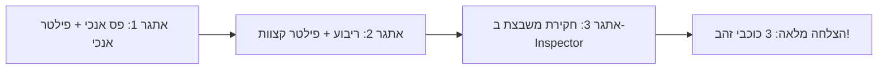

# מערך שיעור מובנה: מעבדה 6 – ראייה ממוחשבת, פילטרים וקונבולוציה
## מסלול ב׳: בינה מלאכותית ולמידת מכונה • בית ספר יסודי

---

### פרטי השיעור ונתוני מפתח
* **שכבת גיל:** בית ספר יסודי (גילאי 10–11).
* **משך השיעור:** 45 דקות (כולל מתווה הרחבה לסדנה כפולה של 90 דקות).
* **סביבת עבודה:** [ZenLab – מעבדה 6: מעבדת ראייה ממוחשבת ופילטרים (`Lab6_VisionKernels`)].
* **דרישות מוקדמות:** הבנת מושג הפיקסל וייצוג בינארי (מעבדה 1), פעולות כפל וחיבור של מספרים שלמים ומספרים מכוונים פשוטים ($-1, 0, 1$).
* **תאימות לתוכנית הלימודים:** מחוון אוריינות בינה מלאכותית של משרד החינוך (עיבוד תמונה דיגיטלי, חילוץ מאפיינים), תקני **AI4K12** – רעיון מרכזי 1: תפיסה (Perception) ורעיון מרכזי 5: השפעה חברתית ואתיקה (Societal Impact & Ethics).
* **עקרון פדגוגי מרכזי:** **Glass-Box Learning** – חשיפת פעולת הקונבולוציה המסתורית כהכפלה וסכימה פשוטה של משבצות שכנות ("זכוכית מגדלת בלשית"), ספירלת ברונר (פעיל $\to$ איקוני $\to$ סמלי), ושמירה מחמירה על אפס איסוף נתונים (Zero-PII).

---

### 1. מטרות הוראה אופרטיביות

בסיום השיעור, התלמיד/ה יהיו מסוגלים:
1. **ידע והבנה קוגניטיבית:**
   * להסביר כיצד מחשב או מצלמה של רכב אוטונומי "רואים" תמונה לא כאובייקטים אלא כרשת של מספרים (ערכי בהירות פיקסלים).
   * להגדיר מהו **פילטר / ליבת קונבולוציה (Kernel)** בגודל $3 \times 3$ וכיצד הוא "סורק" את התמונה משבצת אחר משבצת.
   * להבין ש**קצה או גבול של עצם (Edge)** נוצר במקום שבו יש קפיצה חדה בערכי הפיקסלים (הפרש צבע בין שחור ללבן).
   * להסביר את הרעיון שמאחורי **רשתות קונבולוציה (CNN)** וכיצד מנגנון זיהוי פנים בטלפון (FaceID) בונה הבנה היררכית: מקווים פשוטים $\to$ לצורות $\to$ לפנים שלמות.
2. **מיומנות מחשובית וחקר מעשי:**
   * להפעיל פילטרים שונים (גילוי קצוות אנכיים, גילוי קצוות אופקיים, חידוד, טשטוש) ולחזות מראש את התוצאה הוויזואלית.
   * לבצע פירוק מתמטי של תא בודד בעזרת כלי ה-Inspector של המעבדה: פעולת כפל פשוטה בין ערך הפיקסל למשקולת הפילטר וסכימת התוצאות.
   * לחקור כיצד פילטר קצוות אנכי (Vertical Sobel) מבליט קווים זקופים ומעלים קווים שוכבים, ולהיפך.
3. **הבנה אתית וחברתית (AI Ethics):**
   * להסביר את הסיכונים בראייה ממוחשבת כאשר התאורה לקויה, בתנאי מזג אוויר קשים (ערפל, גשם כבד) או בהסתרות חלקיות.
   * לדון בסכנות של טעויות זיהוי במצלמות אבטחה וזיהוי פנים אוטונומי וצורך בבקרה אנושית (Human-in-the-Loop).

---

### 2. מושגי מפתח להנחלה (Glossary)

| מושג בעברית | מושג מקצועי (CS/AI) | הסבר מותאם לגיל 10 |
| :--- | :--- | :--- |
| **ראייה ממוחשבת** | Computer Vision | היכולת של מחשב לקלוט תמונות או סרטונים מחיישנים ולהבין אילו חפצים ואנשים נמצאים בהם. |
| **קונבולוציה (סריקה מקומית)** | Convolution | פעולה שבה חלון קטן מחליק על פני כל משבצות התמונה, משווה כל פיקסל לשכניו ומייצר תמונה חדשה. |
| **ליבת פילטר** | Convolution Kernel / Filter | ריבוע קטן בגודל $3 \times 3$ המכיל משקולות (מספרים), שמתפקד כמו "זכוכית מגדלת בלשית" שמחפשת דפוס מסוים. |
| **מזהה קצוות סובל** | Sobel Edge Detector | פילטר מפורסם שיודע למצוא קפיצות חדות בצבע: פילטר אנכי מזהה עמודים, ופילטר אופקי מזהה פסים שוכבים. |
| **מפת מאפיינים** | Feature Map | התמונה החדשה שמתקבלת אחרי הפעלת הפילטר, שבה מוארים רק הקווים והפרטים שהפילטר חיפש. |
| **טשטוש ממוצע** | Box Blur | פילטר שמערבב את הצבע של כל משבצת עם 8 השכנים שלה, כדי לרכך את התמונה ולהעלים לכלוכים ורעשים. |
| **רשת עצבית קונבולוציונית** | CNN (Convolutional Neural Network) | מוח מלאכותי לראייה הבנוי משכבות רבות של פילטרים: שכבה אחת מוצאת קווים, הבאה מוצאת עיניים ואף, והאחרונה מזהה את כל האדם. |

---

### 3. פעילות פתיחה ללא מחשב (Unplugged Activity, 7 דקות)
#### שם הפעילות: "זכוכית המגדלת הבלשית – מוצאים את הגבולות הנסתרים"

**מטרת הפעילות:** המחשת עקרון הסריקה המקומית ($3 \times 3$) וההבדל בין משטח אחיד לקו גבול, בעזרת תנועה פיזית וחישוב מהיר על הלוח.

**ציוד נדרש:**
* מסגרת קרטון חלולה בגודל $3 \times 3$ משבצות (ניתן להכין מקרטון ביצים גזור או בריסטול מחורר).
* ציור פשוט על לוח הכיתה: רשת של $6 \times 6$ משבצות, כאשר העמודות 1–3 צבועות בלבן (ערך 1) והעמודות 4–6 שחורות (ערך 0).

**מהלך הפעילות דקה אחר דקה:**
1. **דקה 0–2 (אתגר הראייה):** המורה שואל/ת: "כשאנחנו מביטים על הלוח, אנחנו רואים מיד קו מפריד ברור בין האזור הלבן לאזור השחור. אבל המצלמה בטלפון לא רואה קו – היא רואה רק מיליוני מספרים של 1 ו-0. איך היא מגלה איפה הקו עובר?"
2. **דקה 2–4 (סריקת המסגרת הבלשית):**
   * תלמיד/ה מתנדב/ת ניגש/ת ללוח עם מסגרת הקרטון ($3 \times 3$).
   * מניחים את המסגרת עמוק בתוך האזור הלבן (כל 9 המשבצות הן 1). המורה שואל/ת: "האם יש כאן הבדל בין ימין לשמאל?" $\to$ "לא, הכל אותו דבר!".
   * מניחים את המסגרת עמוק בתוך האזור השחור (כל 9 המשבצות הן 0). האם יש הבדל? $\to$ "לא, שוב הכל אחיד!".
3. **דקה 4–6 (גילוי הקצה):**
   * כעת מניחים את המסגרת בדיוק על קו התפר: 3 המשבצות משמאל הן 1, ו-3 המשבצות מימין הן 0!
   * המורה: "מה קורה עכשיו בתוך החלון שלנו? צד אחד מואר וצד שני חשוך! קפיצה של 100%! הפילטר צועק למחשב: **מצאתי קו גבול!**".
4. **דקה 6–7 (מעבר למעבדה):**
   * "בדיוק כך פועלת מכונית שנוסעת בכביש: היא מזיזה מיליוני זכוכיות מגדלת כאלה בכל שבריר שנייה כדי לגלות איפה מסתיים הכביש ואיפה מתחיל המדרכה. בואו נפתח את המעבדה ונראה את הקסם קורה!"

---

### 4. תסריט מהלך שיעור דקה-אחר-דקה (Lesson Timeline & Script)

```
┌─────────────────────────────────────────────────────────────────────────────┐
│                             ציר זמן השיעור (45 דק')                         │
├─────────────┬─────────────┬──────────────────────────┬──────────────────────┤
│  00 - 07 דק'│  07 - 15 דק'│        15 - 32 דק'       │ 32 - 40 דק'│ 40-45 דק│
│  פעילות ללא │ תיווך מושגי │  התנסות מעשית ב-ZenLab   │ פירוק מתמטי│ סיכום   │
│    מחשב     │ והדגמת לוח  │ 3 אתגרים + חקר פילטרים   │  ו-FaceID  │ וכרטיס  │
│ (Unplugged) │ (Frontal)   │ (Hands-on Exploration)   │    (CNN)   │  יציאה  │
└─────────────┴─────────────┴──────────────────────────┴──────────────────────┘
```

#### שלב 1: תיווך מושגי והדגמת הממשק (דקות 07:00 – 15:00)
* **דברי המורה (הוראה מתווכת):**
  > "במעבדה 1 למדנו שציור במחשב בנוי מפיקסלים. היום נלמד איך המחשב לא רק מציג פיקסלים אלא גם מבין מה מצויר בהם.
  > המחשב משתמש בכלי שנקרא **פילטר (Kernel)**. פילטר הוא מטריצה קטנה של 3 על 3 משבצות. כל משבצת בפילטר מחזיקה מספר קטן: לפעמים מספר חיובי ($+1$), לפעמים שלילי ($-1$) ולפעמים אפס.
  > כשהפילטר גולש על הציור שלנו, הוא מכפיל את הפיקסלים במספרים שלו. אם יש קו – הוא מדליק אור חזק בתמונה החדשה!"
* **הדגמה על המסך המרכזי:**
  * פתיחת מעבדה 6.
  * הצגת שני הלוחות: בצד ימין "הציור המקורי שלכם" (רשת של $8 \times 8$), ובצד שמאל "מה שהמחשב מזהה (מפת הקווים)".
  * לחיצה על תבנית **פס אנכי (Vertical Stripe)** ובחירת פילטר **קצוות אנכיים (Vertical Sobel)**.
  * שימו לב כיצד במפת הקווים נדלקים שני פסים ירוקים זוהרים בדיוק לאורך שולי הפס!

#### שלב 2: התנסות אישית/בזוגות במעבדה ופיצוח אתגרים (דקות 15:00 – 32:00)
התלמידים פותחים את המעבדה ועובדים בעזרת דף החקר.

* **הנחיית המורה במהלך השיטוט בכיתה:**
  * *מול תלמיד שמנסה לפתור את אתגר 1:* "בחרת תבנית 'פס אנכי'? עכשיו תלחץ על הפילטר 'קצוות אנכיים'. תסתכל על הלוח השמאלי – איזה מספרים הופיעו שם?"
  * *מול תלמיד באתגר 2 (ריבוע מרכזי):* "הפעלת פילטר קצוות על הריבוע? שים לב: למה הפילטר האנכי האיר רק את הקירות הימניים והשמאליים של הריבוע? איזה פילטר צריך כדי להאיר את התקרה והרצפה של הריבוע?" $\to$ הילד מגלה את פילטר **קצוות אופקיים**!
  * *מול תלמיד באתגר 3 (בלש המשבצות):* "לחץ עם העכבר על אחת המשבצות הירוקות הזוהרות. תסתכל בתיבה שמתחת: מה המחשב כותב על 'הצצה לחשבון של המשבצת'?"

#### שלב 3: פירוק מתמטי ידידותי לגיל 10 וחיבור ל-CNN (דקות 32:00 – 40:00)
עצירת עבודה קצרה והתכנסות אל הלוח:
* המורה כותב/ת על הלוח את מטריצת הפילטר האנכי:
  $$\begin{bmatrix} -1 & 0 & +1 \\ -1 & 0 & +1 \\ -1 & 0 & +1 \end{bmatrix}$$
* **הסבר מתמטי שכל ילד מבין:**
  > "בואו נראה למה הפילטר הזה הוא גאון!
  > נניח שמשמאל יש שחור ($0$) ומימין יש לבן ($1$).
  > נכפיל: המשבצות השמאליות הן $0 \times (-1) = 0$.
  > האמצע הוא אפס.
  > המשבצות הימניות הן $1 \times (+1) = 1$.
  > יש לנו שלוש משבצות מימין, אז נחבר: $1 + 1 + 1 = 3$! קיבלנו ציון ענק! האור נדלק בירוק זוהר!
  > אבל מה אם כל המשבצות לבנות לגמרי ($1$)?
  > צד שמאל: $1 \times (-1) = -1$ (שלוש פעמים זה $-3$).
  > צד ימין: $1 \times (+1) = +1$ (שלוש פעמים זה $+3$).
  > נחבר הכל: $-3 + 3 = 0$! אפס עגול! האור נכבה!"
* **חיבור לטכנולוגיית FaceID ברשתות קונבולוציה (CNN):**
  > "איך הטלפון מזהה את הפנים שלכם?
  > הוא לא מסתכל על הכל בבת אחת.
  > **שכבה 1:** עשרות פילטרים כאלה מוצאים קווים אופקיים ואנכיים.
  > **שכבה 2:** פילטרים הבאים מחברים את הקווים לצורות: עיגול של אישון, קשת של גבה, משולש של אף.
  > **שכבה 3:** המחשב בודק את המרחקים בין העיניים לאף ולפה – ופותח את הטלפון רק אם הפנים תואמות!"

#### שלב 4: סיכום כיתתי, אתיקה וסיום (דקות 40:00 – 45:00)
* **דיון קצר באתיקה ומגבלות ראייה ממוחשבת:**
  * "מדוע קשה למצלמה לזהות מעבר חצייה כשנוסעים בשלג כבד או בסופת חול?" (כי ההפרש בצבע נעלם – הכל לבן או אפור, והפילטר מוציא אפס!).
  * "מה הסכנה אם מערכת זיהוי פנים משטרתית מתבלבלת בגלל תאורת רחוב חלשה?"
* איסוף דפי החקר ומילוי כרטיס יציאה.

---

### 5. מדריך פיצוח מעשי ל-3 אתגרי המעבדה ב-ZenLab



#### אתגר 1: "גילוי פסים ישרים מלמעלה למטה" (`lab6_challenge1`)
* **המשימה הנדרשת:** בחירת תבנית "פס ישר" והפעלת הפילטר "קצוות אנכיים" כדי לראות את הקווים זוהרים.
* **איך מבצעים בפועל בממשק:**
  1. בשורת התבניות העליונה, לוחצים על הכפתור **פס אנכי** (הציור המקורי יציג שני עמודי פיקסלים כחולים במרכז).
  2. בתיבת הפילטרים, לוחצים על הכפתור **קצוות אנכיים (Vertical Sobel)**.
  3. ברשת התוצאה השמאלית ("מה שהמחשב מזהה"), שני קווי הגבול של הפס נדלקים מיד במספרים גבוהים ($1.0$).
* **טריגר ההצלחה בקוד:** `selectedPreset === 'verticalStripe' && activeKernelKey === 'verticalEdge'`.
* **משוב המערכת:** כוכב ראשון מוענק, צליל הצלחה קצר, והודעה: "הפילטר הבלשי זיהה את הקווים הישרים והאיר אותם!".

#### אתגר 2: "גילוי מסגרת של ריבוע" (`lab6_challenge2`)
* **המשימה הנדרשת:** הפעלת פילטר קצוות על תבנית הריבוע כך שרק המסגרת החיצונית תאיר.
* **איך מבצעים בפועל בממשק:**
  1. לוחצים על תבנית **ריבוע מרכזי** ברשימת התבניות.
  2. לוחצים על פילטר **קצוות אופקיים (Horizontal Sobel)**.
  3. שמים לב שהקו העליון והקו התחתון של הריבוע נדלקים בעוצמה מקסימלית, בעוד שמרכז הריבוע השחור נשאר חשוך לחלוטין.
* **טריגר ההצלחה בקוד:** `selectedPreset === 'square' && activeKernelKey === 'horizontalEdge'`.
* **משוב המערכת:** כוכב שני מוענק עם אפקט קונפטי!

#### אתגר 3: "הבלש של המשבצות (בדיקת תא בודד)" (`lab6_challenge3`)
* **המשימה הנדרשת:** לחיצה על משבצת כלשהי ברשת המחשב ובחינת אופן השוואת 8 המשבצות השכנות.
* **איך מבצעים בפועל בממשק:**
  1. לוחצים עם העכבר או האצבע על אחת המשבצות הזוהרות ברשת השמאלית (למשל המשבצת $(3, 3)$).
  2. המשבצת שנבחרה מקבלת מסגרת ירוקה מודגשת.
  3. בו-זמנית, ברשת הימנית מופיעה מסגרת צהובה מודגשת סביב 9 המשבצות הרלוונטיות ($3 \times 3$).
  4. בחלק התחתון נפתח חלון מיוחד: **הצצה לחשבון של המשבצת**, המציג את סכום הכפל (Sum) ואת ציון ההתאמה (Clamped).
* **טריגר ההצלחה בקוד:** `Boolean(inspectedCell)`.
* **משוב המערכת:** כוכב שלישי נדלק, 3 כוכבים שלמים במעבדה!

---

### 6. פירוק מתמטי ידידותי לגיל 10 של פעולת הקונבולוציה

כדי להנגיש את המושג האלגברי המורכב של קונבולוציה לתלמידי בית ספר יסודי, נציג את החישוב כ**משחק "תופסים את ההפרש"**:

```
רשת התמונה המקורית (3x3):            פילטר סובל אנכי (3x3):
┌──────────┬──────────┬──────────┐    ┌──────────┬──────────┬──────────┐
│ משבצת 0  │ משבצת 1  │ משבצת 1  │    │   -1     │    0     │   +1     │
├──────────┼──────────┼──────────┤    ├──────────┼──────────┼──────────┤
│ משבצת 0  │ משבצת 1  │ משבצת 1  │  X │   -1     │    0     │   +1     │
├──────────┼──────────┼──────────┤    ├──────────┼──────────┼──────────┤
│ משבצת 0  │ משבצת 1  │ משבצת 1  │    │   -1     │    0     │   +1     │
└──────────┴──────────┴──────────┘    └──────────┴──────────┴──────────┘
```

#### חישוב צעד אחר צעד (כפל עמודות):
1. **עמודה שמאלית (צבע שחור, ערך 0):**
   * משבצת עליונה: $0 \times (-1) = 0$
   * משבצת אמצעית: $0 \times (-1) = 0$
   * משבצת תחתונה: $0 \times (-1) = 0$
   * *סכום עמודה שמאלית:* $0$
2. **עמודה מרכזית (צבע לבן, ערך 1):**
   * משבצת עליונה: $1 \times 0 = 0$
   * משבצת אמצעית: $1 \times 0 = 0$
   * משבצת תחתונה: $1 \times 0 = 0$
   * *סכום עמודה מרכזית:* $0$
3. **עמודה ימנית (צבע לבן, ערך 1):**
   * משבצת עליונה: $1 \times (+1) = +1$
   * משבצת אמצעית: $1 \times (+1) = +1$
   * משבצת תחתונה: $1 \times (+1) = +1$
   * *סכום עמודה ימנית:* $+3$
4. **סיכום כולל של כל 9 המשבצות:**
   $$\text{Total Sum} = 0 + 0 + 3 = +3$$
5. **תוצאה במחשב:**
   התוצאה גדולה מאוד! המחשב חותך את המספר לטווח שבין 0 ל-1, וצובע את המשבצת החדשה ב**ירוק זוהר מלא (1.0)**! מצאנו קצה חד וברור!

> [!TIP]
> **שאלת קסם לתלמידים:** "מה יקרה אם כל המשבצות בציור יהיו שחורות ($0$)? מה תהיה התוצאה?"  
> כל המכפלות יהיו אפס, הסכום יהיה אפס $\to$ שום דבר לא זוהר!

---

### 7. משימת ארגז חול יצירתית (Creative Sandbox Challenge)
#### שם המשימה: "צייר הקוד החשאי – כתב חרטומים דיגיטלי"

**תיאור המשימה לתלמידים מתקדמים:**
1. לחצו על כפתור **איפוס הלוח (ניקוי)** כדי לקבל לוח ריק לגמרי.
2. ציירו בלוח המקורי אות ראשונה של שמכם (למשל האות **L**, **T**, או **H**) בעזרת לחיצה על משבצות.
3. כעת, בחרו בפילטר **קצוות אנכיים**: אילו חלקים מהאות שלכם מופיעים במפת הקווים? (רק הקווים היורדים למטה!).
4. החליפו לפילטר **קצוות אופקיים**: איזה חלק הופיע עכשיו? (הגגות והקווים השוכבים!).
5. **האתגר:** ציירו צורה מיוחדת שמסוגלת "להערים" על הפילטר האנכי (כלומר שהפילטר האנכי יציג בה רק אפסים), אך תידלק בעוצמה מלאה תחת הפילטר האופקי! (רמז: פסים שוכבים בלבד!).

---

### 8. תפיסות שגויות נפוצות של תלמידים (Misconceptions) ופירוקן

#### תפיסה שגויה 1: "המצלמה של המחשב מבינה מה זה חתול או מכונית ברגע שהיא מצלמת"
* **ההסבר המוטעה של התלמיד:** "המצלמה רואה שיש שם גלגלים וחלון."
* **כיצד המורה מפרק/ת:** מזכירים לתלמידים שמצלמה היא רק מדור של פיקסלים. מחשב לא יודע מה זה "גלגל". הוא רק יודע שיש עיגול של קפיצות צבע. נדרשות עשרות שכבות של פילטרים במוח מלאכותי כדי לחבר קווים פשוטים לכדי מושג מופשט של "רכב".

#### תפיסה שגויה 2: "פילטר טשטוש (Blur) הוא פילטר מקולקל שמקלקל את התמונה"
* **ההסבר המוטעה של התלמיד:** "למה שנרצה לטשטש תמונה? הרי תמונה מטושטשת היא פחות ברורה!"
* **כיצד המורה מפרק/ת:** מסבירים את תפקיד ניקוי הרעשים (Denoising): בתמונות אמיתיות יש לכלוך על העדשה, טיפות גשם, או גרגרים דיגיטליים. אם נפעיל זיהוי קצוות ישירות, המחשב יחשוב שכל גרגר אבק הוא אדם במעבר חצייה! פילטר טשטוש "מחליק" את השטח כדי שהקווים האמיתיים יבלטו.

#### תפיסה שגויה 3: "פילטר אחד יכול לגלות בבת אחת את כל סוגי הקווים"
* **ההסבר המוטעה של התלמיד:** "למה צריך לבחור בין פילטר אנכי לאופקי? שהמחשב ימצא הכל ביחד!"
* **כיצד המורה מפרק/ת:** מראים מתמטית שפילטר שמומחה בגילוי קפיצות שמאלה-ימינה ($-1, 0, 1$) מבטל לחלוטין שורות אופקיות כי המספרים בהן זהים לאורך העמודה. ראייה ממוחשבת מבוססת על **צוות מומחים**: פילטר אחד לעמודים, פילטר שני לפסים, ופילטר שלישי לאלכסונים.

---

### 9. דיפרנציאציה והתאמה אישית (Inclusion & Extension)

#### פיגומים לתלמידים הזקוקים לתמיכה (Scaffolding):
* **עבודה בזוגות משלימים:** תלמיד אחד אחראי על בחירת הפילטר והתבנית, והתלמיד השני אחראי על לחיצה ובדיקת ה-Inspector.
* **הסבר גרפי ללא סימני מינוס:** הצגת הפילטר כ"מאזניים": צד ימין מול צד שמאל. אם הצדדים מאוזנים $\to$ אין קו. אם צד אחד כבד $\to$ יש קו!
* **מדריך צעד-אחר-צעד מאויר:** כרטיס עם מספור משימות (1. בחר פס $\to$ 2. בחר פילטר אנכי $\to$ 3. ראה כוכב).

#### אתגרי הרחבה והעמקה למצטיינים (Extension Challenges):
* **פילטר אלכסוני (Diagonal Kernel):** כיצד הייתה נראית מטריצת $3 \times 3$ שהייתה יודעת לזהות קו אלכסוני בזווית 45 מעלות? (איפה נמקם את ה-$+1$ ואיפה את ה-$-1$?).
* **פילטר חידוד (Sharpen):** הסתכלו על מטריצת החידוד במעבדה (הערך המרכזי הוא $5$ וארבעת שכניו הם $-1$). מה הפילטר הזה עושה כשפיקסל בודד שונה מכל שכניו? (מבליט אותו בעוצמה פי 5 ומכהה את הרקע).

---

### 10. דף עבודה וכרטיסיית חקר מודפסת לתלמיד (Printable Worksheet)

```text
================================================================================
               כרטיסיית חוקר ראייה ממוחשבת • מעבדה 6: פילטרים וקונבולוציה
שם החוקר/ת: __________________   כיתה: _________   תאריך: ______________
================================================================================

חלק א׳: התבניות והפילטרים הבלשיים
1. היכנסו למעבדה 6 ב-ZenLab.
2. בחרו בתבנית "פס אנכי" ובפילטר "קצוות אנכיים".
   מה קרה לקווים במפת הקווים של המחשב?
   [ ] נעלמו לגמרי        [ ] נדלקו בצבע ירוק זוהר        [ ] נהיו מטושטשים

3. השאירו את התבנית על "פס אנכי", אך שנו את הפילטר ל-"קצוות אופקיים".
   האם הקווים עדיין זוהרים? מדוע לדעתכם?
   תשובה: ____________________________________________________________________

--------------------------------------------------------------------------------
חלק ב׳: פענוח ריבוע ומסגרות
1. בחרו בתבנית "ריבוע מרכזי".
2. בדקו איזה פילטר מאיר את הקווים העומדים (ימין ושמאל) של הריבוע: ________________
3. איזה פילטר מאיר את הקווים השוכבים (למעלה ולמטה) של הריבוע: ________________

--------------------------------------------------------------------------------
חלק ג׳: חקירת משבצת בודדת (Inspector)
1. לחצו על אחת המשבצות הירוקות הזוהרות ברשת השמאלית.
2. הביטו בחלון שנפתח למטה ומלאו את הנתונים:
   * מיקום המשבצת שנבדקה: X = _____ , Y = _____
   * סכום המכפלות (Sum) שחישב המחשב: ______________
   * ציון ההתאמה (Clamped): ______________
3. כעת לחצו על משבצת שחורה כבויה (ערך 0). מה סכום המכפלות שלה? ____________

--------------------------------------------------------------------------------
חלק ד׳: כרטיס יציאה (Exit Ticket) – חיבור לעולם האמיתי (FaceID)
כיצד מצלמת הטלפון משתמשת בפילטרים שלמדנו היום כדי לדעת שהפנים שלכם נמצאות
מול המסך ולא פנים של אדם זר? (רמז: חשבו על קווי המתאר של העיניים והאף).
תשובה: _______________________________________________________________________
________________________________________________________________________________
================================================================================
```

---

### 11. מחוון הערכה למורה (Rubric) ומשימת בית

#### מחוון הערכה (100 נקודות):
* **ביצוע מעשי במעבדה (30 נק'):** השלמת 3 אתגרי המעבדה וקבלת 3 כוכבים (פס אנכי, ריבוע, ובדיקת משבצת).
* **דיוק בתיעוד חקר ה-Inspector (30 נק'):** רישום נכון של ערכי המשבצת (Sum ו-Clamped) מתוך חלון הבדיקה.
* **הבנה אלגוריתמית של כיווניות הפילטר (20 נק'):** הסבר נכון מדוע פילטר אופקי אינו מזהה פס אנכי.
* **יישום בעולם האמיתי ובטיחות (20 נק'):** תשובה מנומקת בכרטיס היציאה המקשרת בין זיהוי קצוות היררכי לטכנולוגיית זיהוי פנים ורכב אוטונומי.

#### משימת בית קצרה לחשיבה (בלש התמונות המשפחתי):
"הראו להורים תמונה כלשהי בטלפון.  
הסבירו להם כיצד 'פילטר בלשי' עובר על התמונה ומוצא את קווי המתאר שלה.  
שאלו אותם: האם הם היו סומכים על מכונית ללא נהג שנוסעת בגשם שוטף בלילה? מה יכול לעזור למכונית כשהמצלמה מתקשה לראות? (רמז: חיישני לייזר LiDAR או מכ״ם רדיו!). כתבו 2 משפטים במחברת."
