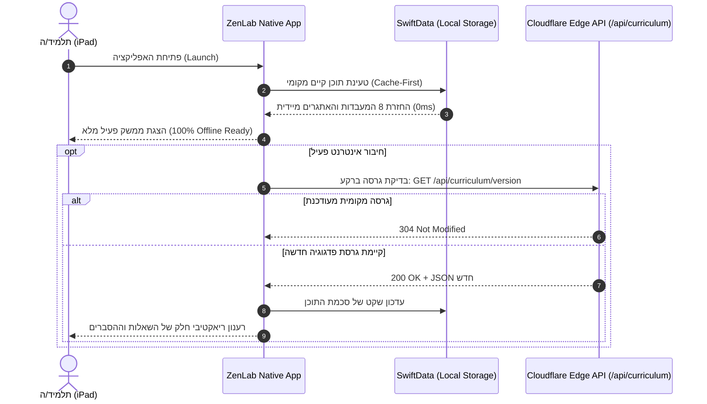

# RFC 003: ארכיטקטורת מערכות לאפליקציות Native (Apple iOS/iPadOS ו-Android)
## תוכנית הנדסית למונוריפו, Frameworks מקוריים של Apple, ושפת Jetpack Compose

**מזהה מסמך:** `RFC-003-NATIVE-ARCHITECTURE-2026`  
**תאריך:** אוקטובר 2026  
**סטטוס:** מוצע ומאושר ליישום הדרגתי (Proposed / Approved for Phased Execution)  
**צוות:** Code & AI Explorer Team (`team@learnai.internal`)  
**מסמכים קשורים:** `RFC_001_CORE_ARCHITECTURE.md`, `RFC_002_EIGHT_LAB_MASTER_SUITE.md`, `NATIVE_APPS_FEASIBILITY_AND_MARKET_STUDY.he.md`  

---

## 1. רקע ומטרות

פרויקט ZenLab שואף לספק חוויית למידה אופטימלית ומוחשית לעקרונות המחשב ובינה מלאכותית לתלמידי כיתה ה'.  
בשלב הראשון פותח ממשק Web SPA מודרני. מסמך זה מגדיר את הארכיטקטורה ההנדסית להרחבת המערכת ל**אפליקציית Apple Native מלאה (100% Native ב-SwiftUI)** ולאחר מכן ל**אפליקציית Android מקורית (Jetpack Compose)**, תחת מאגר קוד אחוד (Monorepo) וחוזה נתונים פדגוגי יחיד.

### מטרות מרכזיות:
1. **אפס היברידיות (Zero WebViews / Zero Capacitor)**: חוויית 100% Native חלקה ומואצת חומרה.
2. **תאימות מלאה ל-Apple HIG**: זכוכית נוזלית (`.ultraThinMaterial`), סמלי SF Symbols 6, משוב מגע (CoreHaptics), וצלילים פנטטוניים ב-AVFoundation ללא שום קבצי מדיה חיצוניים.
3. **עצמאות אופליין מלאה (Local-First)**: פעולה מיידית ללא תלות ברשת בעגלות אייפדים שיתופיות בבתי ספר באמצעות SwiftData.
4. **תאימות ל-Android**: תרגום עקרונות ה-HIG של אפל לשפת Jetpack Compose, Material 3 ו-Room Database.
5. **עדכון פדגוגי שוטף (Server-Driven Curriculum)**: שינוי תכנים, הוספת שאלות ותיקון אתגרים משרתי הקצה של Cloudflare ללא צורך בהמתנה לאישור מחודש של חנויות האפליקציות.

---

## 2. מבנה המאגר האחוד (Monorepo Blueprint)

כדי להימנע מפיצול גרסאות, הפרויקט יאורגן במבנה מודולרי:

```text
LearnAI/
├── shared/                       # חוזה נתונים אחוד (Single Source of Truth)
│   ├── curriculum.json           # הגדרות כל 8 המעבדות, שלבי התיאוריה והאתגרים
│   └── assets/                   # נכסים גרפיים וסמלים משותפים
│
├── web/                          # אפליקציית הווב הקיימת (React + Vite + Tailwind)
│   ├── src/
│   ├── public/
│   └── package.json
│
├── ios/                          # אפליקציית Apple Native (Swift 6 + SwiftUI)
│   ├── ZenLab.xcodeproj          # פרויקט Xcode מנוהל SPM בלבד
│   ├── ZenLab/
│   │   ├── App/                  # ZenLabApp.swift, NavigationSplitView
│   │   ├── Core/                 # AudioSynthesizer, HapticManager, Storage
│   │   ├── Models/               # SwiftData Schema, CurriculumCodable
│   │   ├── Views/
│   │   │   ├── Common/           # LiquidGlassCard, ZenButton, MissionBanner
│   │   │   └── Labs/             # Lab1View עד Lab8View (SwiftUI + Metal Canvas)
│   │   └── Resources/            # Bundled curriculum.json, SF Symbols assets
│   └── Tests/                    # XCTest, UI Tests
│
├── android/                      # אפליקציית Android Native (Kotlin + Compose)
│   ├── app/
│   │   ├── src/main/java/...     # Jetpack Compose UI, Room Database
│   │   └── build.gradle.kts
│   └── gradle/
│
├── docs/                         # תיעוד הנדסי, מחקרים ומערכי שיעור
│   ├── lesson_plans/             # 8 מערכי שיעור מובנים לכיתה ה'
│   ├── proposals/                # הצעות ארכיטקטורה (RFCs)
│   └── research/                 # סקרי שוק ומחקר פדגוגי
│
└── functions/                    # Cloudflare Pages Functions (Edge API & AI Tutor)
```

---

## 3. מיפוי ה-Frameworks המקוריים של Apple (100% iOS/iPadOS)

| רכיב מערכת | Apple Native Framework | תפקיד ב-ZenLab | ערך מוסף פדגוגי |
| :--- | :--- | :--- | :--- |
| **ממשק משתמש** | `SwiftUI 6` | `NavigationSplitView` ב-iPad, אדפטיבי ל-iPhone ול-Mac | רספונסיביות טבעית, תמיכה מלאה ב-Dynamic Type ונגישות |
| **חומריות ועיצוב** | `Apple HIG Materials` | `.ultraThinMaterial`, גבולות Specular עדינים | שקט חזותי, היעדר גירויים זרחניים, שפת Zen 2.0 |
| **קנבס וסימולציה** | `SwiftUI.Canvas` / `Metal` | מטריצת פיקסלים 8×8, סריקת Sobel, פריסת נקודות k-NN | רינדור מואץ חומרה ב-120fps חלק ללא שום Latency |
| **מנוע סאונד** | `AVAudioEngine` | סינתזת גלי סינוס לאקורדים פנטטוניים (C5, E5, G5, C6) | אפס תלות בקבצי שמע כבדים, עבודה נקייה עם מתג השתקה |
| **משוב מגע** | `CoreHaptics` | רטט עדין בלחיצה על מתגים, פעימת הצלחה באתגרים | חוויה גופנית (Kinesthetic) שמחברת את הילד לפעולת המחשב |
| **אחסון נתונים** | `SwiftData` | שמירת 24 כוכבים, מעקב אתגרים וחיות בארגז החול | Local-First מוחלט ב-Sandbox המקומי, סנכרון CloudKit שקט |
| **בינה מקומית** | `FoundationModels` / `NaturalLanguage` | טוקניזציה, זיהוי שפה, אימות מושגים במילון | פעולה מיידית ללא תלות ברשת |

---

## 4. ארכיטקטורת אנדרואיד משלימה (Jetpack Compose & Material 3)

בבוא העת, המערכת תתורגם לאנדרואיד בהתאמה מלאה לשפת המערכת של גוגל:

1. **ממשק מוצהר:** `Jetpack Compose` עם ארכיטקטורת MVI / MVVM ו-StateFlow.
2. **חומריות:** משטחי `Material 3 Surface` עם אפקט Blur ו-RenderEffect (באנדרואיד 12+).
3. **מסד נתונים:** `Room Database` המבוסס על סכמת SQLite מקומית זהה ל-SwiftData.
4. **שמע:** `AudioTrack` או ספריית `Oboe (C++)` לסינתזת צלילים נקייה עם שיהוי נמוך.
5. **משוב מגע:** `Vibrator` / `VibrationEffect` המייצרים פעימות Haptic עדינות.

---

## 5. מנגנון סנכרון התוכן מהקצה (Server-Driven Curriculum)

כדי לאפשר עדכוני פדגוגיה שוטפים ללא תלות באישור מחודש של ה-App Store:



---

## 6. שלבי יישום ומפת דרכים הנדסית (Phased Execution)

* **Phase 0 (הכנת סביבה וחוזים):**
  - יצירת תיקיית `ios/` ב-Monorepo.
  - הגדרת קובץ `shared/curriculum.json` משותף.
  - הגדרת כללי `.gitignore` ל-Xcode ול-Swift Package Manager.
* **Phase 1 (תשתית ליבה ומעבדות 1–2 ב-SwiftUI):**
  - הקמת `ZenLabApp.swift` ו-`NavigationSplitView` מותאם לאייפד.
  - מימוש מנועי `ZenAudioSynthesizer` ו-`HapticManager`.
  - בניית מעבדה 1 (פיקסלים וביטים) ומעבדה 2 (רובוט אלגוריתמי).
* **Phase 2 (השלמת 8 המעבדות באייפד):**
  - מימוש מעבדות 3–4 (עץ החלטות ו-A*).
  - מימוש מעבדות 5–8 (k-NN, ראייה ממוחשבת, פרספטרון וטוקנייזר).
  - אינטגרציית `CertificateModal` להדפסה מקומית ב-AirPrint / PDF.
* **Phase 3 (תרגום ל-Android Native):**
  - הקמת פרויקט `android/` ב-Jetpack Compose.
  - חיבור ה-Curriculum המשותף ל-Room Database.
* **Phase 4 (הפצה ואישור בחנויות):**
  - שילוב Parental Gate מתמטי וסינון צ'אט AI מחמיר לקטגוריית Kids ב-App Store.
  - רישום ל-Apple School Manager (VPP) להפצה מוסדית לבתי ספר.
