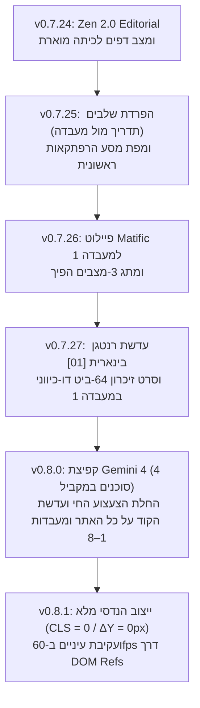

# RFC 004: ארכיטקטורת הצעצוע החי (Matific-Grade Living Toy) ועדשת הקוד הפדגוגית (X-Ray Code Lens)

**מזהה מסמך:** `ZEN-RFC-004-HE`  
**סטטוס:** אושר, מומש במלואו ויוצב בייצור (`v0.7.24` – `v0.8.1`)  
**בעלות:** צוות Code & AI Explorer (`team@learnai.internal`) — ערוץ Design Lead  
**תאריך עדכון:** אוקטובר 2026  

---

## 1. תקציר מנהלים והבעיה העיצובית

בעת השקת גרסאות הליבה הראשונות של **ZenLab** (`v0.1.0` עד `v0.7.23`), 8 המעבדות נבנו כממשקי דשבורד מדעיים קלאסיים (טבלאות, אוגרי זיכרון, מתגים טכניים וגרפים). בעוד שהדיוק האלגוריתמי והפדגוגי לכיתות ה'–ו' היה מלא, עלה מתח מובנה בחוויית המשתמש:
1. **פער הנגישות מול חוויית המשחק**: ממשק טכני טהור עלול להיראות מרתיע או עמוס מדי עבור ילדים בגילאי 10–12 במבט ראשון, לעומת משחקים מוחשיים דוגמת **Matific (עשר אצבעות)**, **Toca Boca** ו-**Duolingo**.
2. **סכנת ההפשטה המוגזמת (הדילמה הפדגוגית)**: הפשטת יתר שבה מסתירים לגמרי את הייצוג המתמטי/חישובי (הביטים `0/1`, הבייטים, משפטי ה-`IF/ELSE`, עלויות החיפוש `f=g+h`, מרחקי ה-$k$-NN, סכומי הקונבולוציה $\Sigma$ והסתברויות ה-Softmax) הופכת את המוצר למשחק צביעה גנרי ומאבדת את ייחודו של ZenLab.
3. **דרישת יציבות פריסה מוחלטת (`CLS = 0` / `ΔY = 0px`)**: בממשק משחקי עשיר הכולל דמות חיה שעוקבת אחרי העכבר ועדשות קוד אינטראקטיביות, כל רינדור מיותר של React או שינוי גובה של רכיבים בעת ריחוף/לחיצה פוגע בחוויית השליטה של התלמיד.

---

## 2. פתרון הליבה: "צעצוע מוחשי חי + עדשת רנטגן חישובית (X-Ray Code Lens)"

במקום לבחור בין "משחק ילדים פשטני" לבין "לוח בקרה הנדסי", גובשה בשיחת ה-Design Lead שפה עיצובית דו-שכבתית אחידה:
- **שכבה 1 — הצעצוע הפיזי החי (The Living Toy Stage)**: כל מעבדה מוצגת כמכשיר פיזי חי בעולם החלל של הרובוט **זֶן (`ZenLivingAvatar`)**, המגיב בזמן אמת (מצבי רוח `happy`, `thinking`, `celebrating`, `error`, עקיבת עיניים ב-60fps ואפקטי צליל פנטטוניים).
- **שכבה 2 — עדשת הרנטגן הפדגוגית (`showXRay` / `עדשת קוד`)**: מתג מוחשי בראש כל מעבדה המאפשר להקרין את השכבה החישובית והמתמטית **ישירות על גבי הצעצוע עצמו** (למשל ספרות `0` ו-`1` חרוטות בתוך נורות הזכוכית וסרט זיכרון חי של 64 ביטים במעבדה 1).
- **שכבה 3 — הפיכות מלאה ב-100% (Zero-Destruction Reversibility)**: בכל מעבדה (1 עד 8) ובדף הבית נשמר מתג מעבר מיידי בין התצוגה המשחקית החדשה (`🌟 פיילוט משחקי (Matific)`) לבין התצוגה המדעית הקלאסית (`🔬 מעבדה מדעית`).

---

## 3. ציר הזמן של האבולוציה העיצובית (`v0.7.24` עד `v0.8.1`)

### שלב א': `v0.7.24` — ליטוש Zen 2.0 ו"מצב דפים (כיתה מוארת)"
- הוספת ערכת נושא דו-מצבית: מצב כהה קוסמי לצד **מצב דפים בהיר (`isDapimActive`)** המותאם למקרנים כיתתיים ולחדרים שטופי שמש.

### שלב ב': `v0.7.25` — חשיפה הדרגתית (Progressive Disclosure) ומפת המסע
- פיצול כל מעבדה לשני שלבים ברורים דרך `LabPhaseHeader.jsx`:
  1. **שלב 1: תדריך ומדיה (`TheoryView.jsx`)** — סרטון, הסבר קולי ומושגי יסוד ללא היסח דעת.
  2. **שלב 2: משחק המחקר** — זירת הניסוי האינטראקטיבית מעל קו הגלילה.
- הוספת `AdventureJourneyMap.jsx` בדף הבית לצד תצוגת הכרטיסיות הכיתתית.

### שלב ג': `v0.7.26` ו-`v0.7.27` — פיילוט הצעצוע החי ועדשת הרנטגן במעבדה 1
- הקמת `MatificPilotLab1.jsx`: זֶן הרובוט מחזיק על בטנו מטריצה של 64 נורות זכוכית פיזיות.
- פיתוח **עדשת הקוד `[01]`**: הקרנת ספרות `0` ו-`1` בתוך הנורות, סרגלי 8 בייטים (`בייט 1`..`בייט 8` + הקסדצימל `0x..`), וסרט נייר 64-ביט דו-כיווני בתחתית הבמה.

### שלב ד': `v0.8.0` — קפיצת המדרגה עם Gemini 4 והחלה על כל האתר (4 סוכנים במקביל)
- עם מעבר השיחה למודל **Gemini 4**, בוצע ניתוח ארכיטקטוני רוחבי ופיצול עבודה (Swarm Orchestration) ל-**4 תת-סוכנים (`invoke_subagent`)** שעבדו במקביל עם הפרדת בעלות קשיחה על קבצים (אפס התנגשויות Git):
  - **רכיבי ליבה משותפים**: `ZenLivingAvatar.jsx` ו-`LudicLabShell.jsx`.
  - **סוכן 1 (מעטפת ומפת הכוכבים)**: שדרוג `AdventureJourneyMap.jsx` ל"מפת הכוכבים של זֶן", ביטול כפילות ה-Hero ב-`HomeDashboard.jsx`, כיווץ `LabPhaseHeader.jsx` ושדרוג `TheoryView.jsx`.
  - **סוכן 2 (מעבדות 2 ו-3)**: `MatificLab2Robot.jsx` (משטח הירח 6×6 + עדשת קואורדינטות `[XY]` וסרט זיכרון פקודות) ו-`MatificLab3Trees.jsx` (מכונת המיון הביולוגית + עדשת תנאים `[IF/ELSE]` ו-4 סלי איסוף).
  - **סוכן 3 (מעבדות 4 ו-5)**: `MatificLab4Pathfinder.jsx` (מכ״ם הניווט החללי 8×8 + עדשת עלויות `[f=g+h]` ומד יעילות A* מול BFS) ו-`MatificLab5Classifier.jsx` (מגרש השכנים בחלל + עדשת מרחקים אוקלידיים `[k-NN]` וקלפי הצבעה).
  - **סוכן 4 (מעבדות 6, 7 ו-8)**: `MatificLab6Vision.jsx` (זכוכית המגדלת הרובוטית + עדשת מכפלות `[3×3]` וסרט סכימה `Σ`), `MatificLab7Perceptron.jsx` (תא הנוירון החשמלי + זירת לייזר 300×300 ועדשת משוואת `Σ`), ו-`MatificLab8Llm.jsx` (מכונת הסיפורים התרמית + ידית טמפרטורה, קפסולות מילים עם Softmax `P%` וטלפרומפטר חי).

### שלב ה': `v0.8.1` — דיבאגינג, ביטול רינדורים מיותרים וייצוב פריסה מוחלט (`CLS = 0`)
- **Zero-Render 60fps Eye Tracking**: החלפת `useState` על תזוזת עכבר ב-`useRef` + `window.requestAnimationFrame` (`translate3d`) ישירות על אלמנטי ה-SVG של אישוני זֶן ב-`ZenLivingAvatar.jsx`.
- **אפס קפיצות גובה (`ΔY = 0px`)**: הפיכת חלונית "איך זה עובד?" לשכבה צפה (`absolute top-24 z-40`), נעילת גובה קבועה לכל תיבות הנוסחאות והחישובים של עדשת הקוד במעבדות 2–8, ונעילת גובה בועת הדיבור במפת הכוכבים.
- **אימות אוטומטי ב-Playwright**: בדיקה אוטומטית על פני מפת הכוכבים וכל מעבדות 1–8 אימתה `theoryDeltaY = 0`, `xRayTopDeltaY = 0`, `xRayScrollHeightDelta = 0` ו-`mouseDeltaY = 0`.
