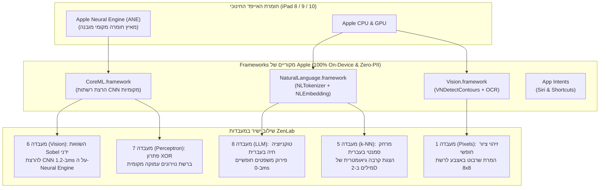

# מסמך אפיון אפליקציה מפורט: ZenLab למכשירי iPad ו-iOS (100% Apple Native)
## מפרט מוצר, ארכיטקטורת חומרה, שפת ממשק HIG וניצול מנועי Apple On-Device AI

**מזהה מסמך:** `SPEC-ZEN-IOS-NATIVE-2026`  
**גרסה:** `1.0.0` (מאושרת ליישום)  
**סטטוס:** מסמך אפיון מחייב (Product & Technical Specification)  
**צוות:** Code & AI Explorer Team (`team@learnai.internal`)  
**משטר פיתוח:** Zero-PII Strict Compliance • 10th Man Red Team Protocol • רישיון פרויקט MIT  
**מסמכים קשורים:** `RFC_003_NATIVE_APPLE_AND_ANDROID_ARCHITECTURE.he.md`, `NATIVE_APPS_FEASIBILITY_AND_MARKET_STUDY.he.md`, `ROADMAP.he.md`  

---

## 1. הגדרת המוצר, יעדי חומרה ומערכת הפעלה

### א. תעודת זהות של האפליקציה
* **שם רשמי:** `ZenLab: From Zero to Neural` (בעברית: `זן-לאב: חשיבה מחשובית ו-AI`).
* **קהל יעד:** תלמידי בית ספר יסודי (גילאי 10–11), מורים למדעי המחשב ביסודי, ובתי ספר.
* **מזהה חבילה (Bundle ID):** `internal.learnai.zenlab` (או תצורת ייצור מתאימה).
* **קטגוריה ב-App Store:** Education / Kids (שכבת גיל 9–11).
* **מודל תמחור:** רכישה חד-פעמית סמלית ($1.99–$2.99 / 7.90–9.90 ₪) עם 50% הנחה למוסדות חינוך ב-Apple School Manager (VPP).

### ב. דרישות מערכת הפעלה וחומרה (The Baseline Target)
* **גרסת מינימום של מערכת ההפעלה:** **`iPadOS 17.0`** (עם תאימות מלאה ל-iPadOS 18 ומעלה).
* **הרציונל ההנדסי לבחירת גרסה 17.0**:
  1. מאפשרת שימוש מלא ב-**`SwiftData`** כמסד נתונים מקומי מהיר ופשוט ללא תקורות של CoreData מיושן.
  2. מאפשרת שימוש במאקרו **`@Observable`** של מערכת ה-Observation המודרנית לניהול מצב ריאקטיבי חלק ללא סרבול Combine.
  3. מעניקה תמיכה מובנית ב-`NavigationSplitView` ורשתות מותאמות טאבלט.
* **דגמי חומרה נתמכים בכיתות (Hardware Compatibility)**:
  - **iPad (הדגם החינוכי הבסיסי):** iPad דור 7 (2019), iPad דור 8 (2020), iPad דור 9 (2021), iPad דור 10 (2022).
  - **כיסוי מוחלט של עגלות בתי הספר בישראל:** מכשירי **iPad דור 8 ודור 9** (שנרכשו באלפיהם בתוכניות גפן וישראל דיגיטלית) מריצים את האפליקציה ב-100% יציבות ומהירות.
  - **iPad Air:** דור 3 (2019) ומעלה.
  - **iPad mini:** דור 5 (2019) ומעלה.
  - **iPad Pro:** כל דגמי 11 אינץ', ודגמי 12.9 אינץ' דור 3 ומעלה.

---

## 2. אסטרטגיית Apple On-Device AI למכשירים חינוכיים

בהתאם למסקנות מחקר ה-10th Man, האפליקציה **אינה מתבססת על Apple Intelligence** (הדורשת שבבי M1+ ו-8GB RAM שאינם קיימים בטאבלטים הבסיסיים בכיתות).  
במקום זאת, האפליקציה מנצלת את מנועי ה-AI והחומרה הקלאסיים של אפל הקיימים **בכל אייפד חינוכי (שבבי A12 ומעלה עם Apple Neural Engine)**:

### פירוט המימושים הייעודיים בכל מעבדה:

1. **מעבדה 8 (טוקנייזר וחיזוי מילים) – `NLTokenizer`**:
   - התלמיד יכול להקליד כל משפט חופשי בעברית או באנגלית בתיבת קלט.
   - מנוע ה-`NLTokenizer(unit: .word)` המובנה של אפל מפרק את המשפט ב-0 מילי-שניות לטוקנים אותנטיים.
   - מציג לילד השוואה ויזואלית: כיצד בני אדם קוראים מילים לעומת איך מחשב מפרק מילים ליחידות עיבוד.

2. **מעבדה 5 (מסווג k-NN ומרחב תכונות) – `NLEmbedding`**:
   - שימוש בוקטורי המילים המובנים של אפל בעברית: `NLEmbedding.wordEmbedding(for: .hebrew)`.
   - התלמיד מזין מילים (כגון "כלב", "חתול", "תפוח", "שולחן"), והאפליקציה מחשבת מרחק סמנטי (`embedding.distance(between:and:)`) ומציגה את הנקודות על גרף דו-ממדי.
   - התלמידים מגלים ש"כלב" ו"חתול" מתקבצים יחד באופן גיאומטרי – הדגמה חיה לאופן שבו AI מבין משמעות.

3. **מעבדה 6 (ראייה ממוחשבת וקונבולוציה) – `CoreML` ו-`Apple Neural Engine`**:
   - לאחר שהתלמיד מזיז ידנית פילטר $3\times3$ ומחשב תא בודד, מופיע כפתור: **"הפעלת מאיץ השבב (Apple Neural Engine)"**.
   - מודל CNN מקומי קומפקטי ב-Core ML (משקל פחות מ-2MB) רץ ישירות על שבב ה-ANE.
   - המסך מציג השוואת זמנים: *"חישוב ידני: 64 פעולות בשנייה. שבב ה-Neural Engine של האייפד ביצע 3.8 מיליון פעולות ב-1.2 מילי-שניות!"*.

4. **מעבדה 7 (פרספטרון ורשתות נוירונים) – פתרון שער XOR**:
   - מעבדה 7 מוכיחה שנוירון בודד נכשל בשער XOR.
   - כפתור **"הפעלת רשת רב-שכבתית מקומית (Core ML)"** מציג רשת נוירונים עמוקה עם שכבה נסתרת (2 שכבות) הלומדת ומפרידה את נקודות ה-XOR ב-100% דיוק ישירות על גבי החומרה.

5. **מעבדה 1 (פיקסלים וביטים) – `Vision.framework`**:
   - בנוסף להקלקה על משבצות, התלמיד יכול לשרבט באצבע או ב-Apple Pencil על משטח רישום.
   - מנוע ה-Vision המקומי מזהה את קווי המתאר (`VNDetectContoursRequest`) וממיר את הצורה אוטומטית לרשת $8 \times 8$ בפיקסלים ובביטים.

---

## 3. שפת עיצוב וחוויית משתמש (Apple HIG & Zen 2.0)

### א. תבנית פריסה מרכזית: `NavigationSplitView`
* **Sidebar (סרגל ניווט ימני ב-iPad, רוחב 280pt)**:
  - מונה כוכבים ראשי (עד 24 כוכבים).
  - רשימת 8 המעבדות עם סמלי `SF Symbols 6` היררכיים (ללא אימוג'ים בסרגל המערכת).
  - אינדיקטור התקדמות לכל מעבדה (0/3 כוכבים וסימון וי ירוק).
  - כפתור איפוס ומעבר לתעודת סיום.
* **Detail (משטח העבודה הפדגוגי)**:
  - בקרת שלבים: מעבר חלק בין `שלב 1: תיאוריה וחקר מושגים` לבין `שלב 2: מעבדה מעשית וארגז חול`.
  - באנר הנחיית משימה אינטראקטיבי בראש המסך (`MissionBannerView`) עם כפתור הקראה קולית (`AVSpeechSynthesizer`) ומגירת רמזים מתקפלת.

### ב. חומריות, צבעים וטיפוגרפיה (Zen Discipline)
* **חומריות זכוכית נוזלית (Liquid Glass)**:
  - כרטיסיות ומעבדות מבוססות `.background(.ultraThinMaterial)` עם גבולות Specular עדינים (`.strokeBorder(.white.opacity(0.12), lineWidth: 1)`).
* **פלטת צבעים שקטה**:
  - רקע עמוק (Deep Slate `#090D16`).
  - גוון הדגשה מותגי יחיד: **Champagne Gold** (`Color(hex: "F59E0B")` או `System Amber`).
  - אפס זרחנות, אפס ניאון, ואפס רעש חזותי.
* **ארגונומיית מגע (Touch Targets)**:
  - כל משבצת במטריצת הפיקסלים (8×8) בגודל של **56×56pt** לפחות באייפד.
  - כפתורי שליטה בגובה 48pt עם שולי מגע נדיבים.

### ג. חוק הכיווניות (Computational LTR vs. Linguistic RTL)
* כל הטקסטים, ההנחיות, הכותרות, הדיאלוגים והכפתורים מוצגים ב-RTL טבעי בעברית (`.environment(\.layoutDirection, .rightToLeft)`).
* **קנבס הסימולציה החישובי** (רשת הפיקסלים, מבוך הרובוט, גרף ה-k-NN וקו הפרדת הנוירון) נעול מפורשות ל-LTR (`.environment(\.layoutDirection, .leftToRight)`), כדי לשמור על מוסכמת מדעי המחשב הבינלאומית שבה נקודת הראשית `[0,0]` ממוקמת בפינה השמאלית-עליונה.

---

## 4. מנועי ליבה וחומרה (Core Engines)

### א. מנוע סאונד פנטטוני עצמאי (`ZenAudioSynthesizer`)
* מבוסס על `AVAudioEngine` וסינתזת גלי סינוס ישירה בזיכרון (PCM Buffers).
* **אקורד Zen פנטטוני מהדהד**: תדרי C5 (523Hz), E5 (659Hz), G5 (784Hz), ו-C6 (1046Hz) עם מעטפת דעיכה אקספוננציאלית (Decay).
* **כיבוד מתג השתקה**: הגדרת `AVAudioSessionCategoryAmbient` המבטיחה פעולה שקטה בהתאם לבחירת המשתמש או המורה.
* מנגנון Debounce של 350ms למניעת עומס שמע בהקלקות מהירות.

### ב. מנוע משוב מגע פיזי (`ZenHapticManager`)
* שימוש ב-`CoreHaptics` ו-`UIFeedbackGenerator`:
  - לחיצה על מתג/פיקסל: רטט עדין מסוג `.rigid` המעניק תחושת מתג מכני ממשי.
  - צעד של הרובוט: נקישה קלה (`.light`).
  - כיבוש אתגר והשגת כוכב: תבנית פעימה מורכבת בת 3 הדגשות עולות (`UINotificationFeedbackGenerator.success`).

### ג. מסד נתונים וסנכרון נתונים (`ZenDataStore`)
* **Local-First מוחלט ב-`SwiftData`**:
  - שמירת 24 הכוכבים, אתגרים פתורים, וחיות מותאמות אישית ישירות ב-App Sandbox של המכשיר.
  - פעולה מיידית של 100% אופליין ללא תלות בקליטת Wi-Fi או בחשבונות משתמשים.
* **סנכרון CloudKit שקט ואופורטוניסטי**:
  - סנכרון נתונים שקט דרך `CKContainer` אך ורק כאשר המכשיר מחובר ל-Apple ID תקין.
  - במידה וחשבון ה-iCloud חסום על ידי ה-MDM הבית-ספרי, האפליקציה מתעלמת בשקט וממשיכה לעבוד באופן מקומי ללא כל חלונית שגיאה.

---

## 5. מנגנון סנכרון תוכן דינמי (Server-Driven Curriculum - SDC)

כדי לאפשר עדכוני פדגוגיה שוטפים ללא תלות בזמני אישור של ה-App Store:
1. **Curriculum מובנה באפליקציה (Bundled Fallback)**:
   - קובץ `bundled_curriculum.json` נארז כמשאב פנימי ומספק פעולה מיידית בהתקנה ראשונה.
2. **סנכרון שקט ברקע (Background Edge Sync)**:
   - בכל הפעלה של האפליקציה (כשיש חיבור אינטרנט), מבוצעת פנייה לשרתי הקצה של Cloudflare: `GET https://zenlab.ninyo.co/api/curriculum/version`.
   - אם מזהה הגרסה חדש יותר, האפליקציה מושכת את ה-JSON המעודכן ושומרת אותו ב-SwiftData.
   - ממשק ה-SwiftUI מבוסס על `@Observable` ומתעדכן ריאקטיבית ומיידית ללא צורך בהפעלה מחדש.

---

## 6. תאימות לחנות האפליקציות וקטגוריית ילדים (App Store Kids Category)

1. **שער הורים מתמטי (Parental Gate)**:
   - כל לחיצה על קישור חיצוני (כגון עמוד הפרויקט ב-GitHub, תנאי שימוש או אתר משרד החינוך) חסומה מאחורי שער הורים: *"כדי להמשיך, פתרו: כמה זה 17 × 4?"*.
2. **משטר Zero-PII מוחלט**:
   - אין טופסי הרשמה, אין צורך בכתובת מייל, אין שמות תלמידים הנשלחים לשרתים.
   - אפס ספריות מעקב (Zero Analytics SDKs / No Tracking IDFA).
3. **בקרת מורה ה-AI**:
   - שאלות לחונך הווירטואלי עוברות אימות קפדני ברמת השרת ונשארות בתחום מדעי המחשב בלבד, לצד כפתור דיווח מובנה על תוכן בלתי הולם (Guideline 1.2).

---

## 7. תוכנית עבודה ושלבי יישום (Implementation Phases)

* **Phase 0: הקמת Monorepo ותשתיות**:
  - פרויקט Xcode בתיקיית `ios/ZenLab` מנוהל SPM בלבד.
  - סכמת `SwiftData` למודל `StudentProgress` ו-`CurriculumSchema`.
* **Phase 1: ממשק מרכזי ומנועי חומרה**:
  - `NavigationSplitView` אדפטיבי ב-SwiftUI 6.
  - מימוש `ZenAudioSynthesizer` (AVAudioEngine) ו-`ZenHapticManager` (CoreHaptics).
* **Phase 2: יישום מעבדות 1–4**:
  - מעבדה 1 (פיקסלים וביטים + זיהוי קווי מתאר ב-Vision).
  - מעבדה 2 (רובוט אלגוריתמי + הרצה בצעד בודד).
  - מעבדה 3 (עץ החלטות + מודאל הוספת חיה מקורית).
  - מעבדה 4 (Pathfinder A* עם קנבס מואץ Metal).
* **Phase 3: יישום מעבדות 5–8 ומנועי AI מקומיים**:
  - מעבדה 5 (k-NN + מרחק סמנטי ב-NLEmbedding).
  - מעבדה 6 (קונבולוציה + מאיץ ה-Apple Neural Engine).
  - מעבדה 7 (פרספטרון + רשת XOR מקומית ב-Core ML).
  - מעבדה 8 (טוקנייזר + פירוק מילים ב-NLTokenizer).
* **Phase 4: בדיקות, VPP והפצה ל-App Store**:
  - בדיקות עמידות בכיתה על גבי מכשירי iPad 8 ו-iPad 9.
  - העלאה ל-TestFlight, אישור ב-App Store תחת קטגוריית Kids, והרשמה ל-Apple School Manager (VPP).
